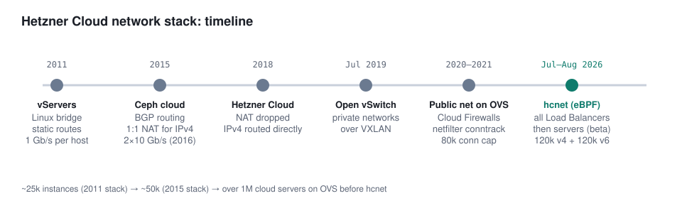
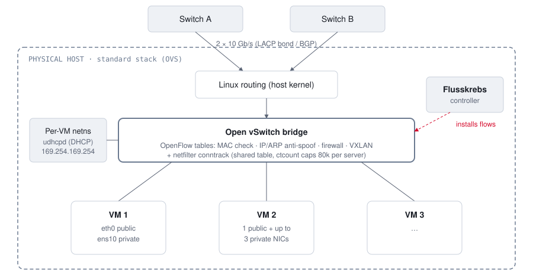
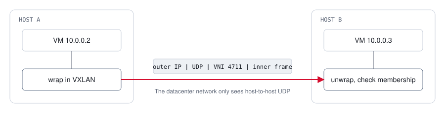
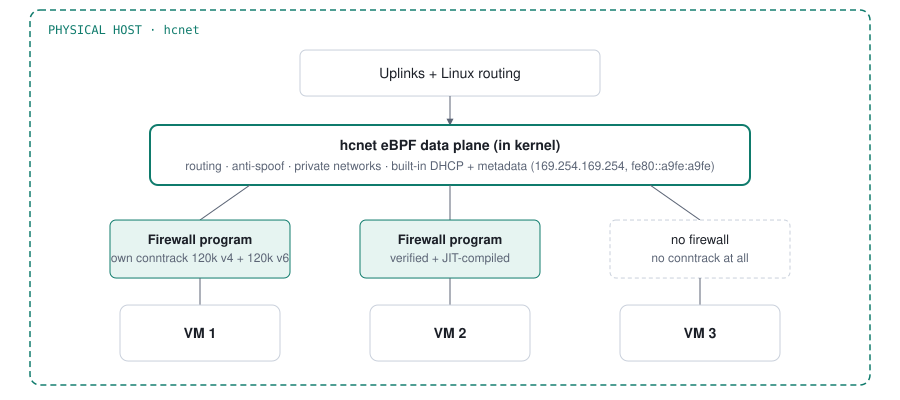
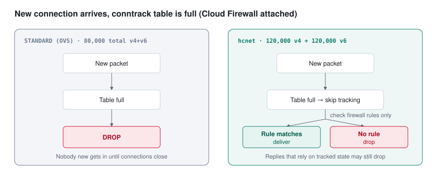
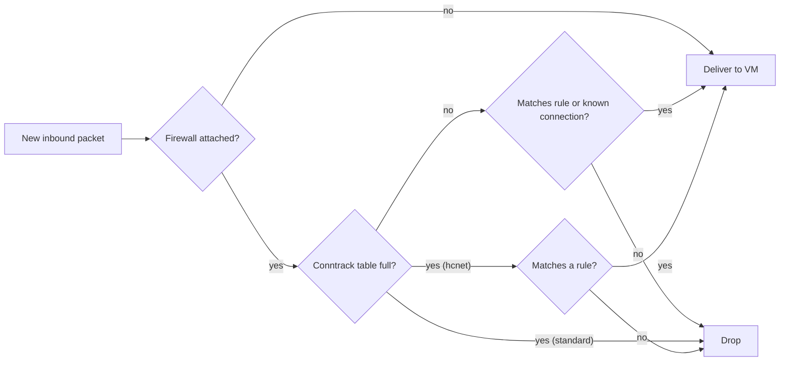

# hetzner-cloud-network-stack

Notes and diagrams on how the Hetzner Cloud network stack works: from the Linux bridges of 2011, through the Open vSwitch (OVS) stack most servers run today, to **hcnet**, the eBPF-based stack that is now in public beta for cloud servers.

These are personal study notes, not official Hetzner documentation. See [Sources](#sources) for the originals.

## In 60 seconds

- Every Hetzner cloud server sits behind software on its **host** that handles firewalls, anti-spoofing, private networks, DHCP and metadata.
- Since 2019 that software has been **Open vSwitch** plus Linux netfilter. Cloud Firewalls track at most **80,000 connections** per server, IPv4 and IPv6 combined.
- **hcnet** replaces it with Hetzner's own **eBPF** stack. Each Cloud Firewall becomes a small compiled program in the kernel, with **120,000 IPv4 + 120,000 IPv6** connections per server. All Hetzner Load Balancers already run on it.
- When the table is full, the old stack drops new connections. hcnet skips tracking and checks packets against your rules only.
- **Performance tradeoff:** an independent benchmark measured 13–21% lower tail latency and 18–39% faster WireGuard on hcnet, but **roughly half the multi-stream TCP receive throughput** (≈10 instead of ≈17 Gbit/s on CCX23). See [benchmarks](docs/benchmarks.md).
- You opt in per server in the Console. Switching causes a short outage, and you may need to renew DHCP or reboot afterwards.
- It mostly matters for servers **with a Cloud Firewall** that handle **many connections at once**.

## Guides

| Guide | Read it when you want to… |
|---|---|
| [Concepts and glossary](docs/concepts.md) | understand OVS, VXLAN, conntrack, eBPF, offloads, metadata and fragments |
| [eBPF in depth](docs/ebpf.md) | see how an eBPF firewall is verified, JIT-compiled and attached, what a full map does, and run a toy hcnet-style firewall in Docker |
| [A packet's journey, hop by hop](docs/packet-journeys.md) | follow 1 MB from VM to VM over a private network, from a VM to the internet, and from the internet to a VM, with the packet's shape and size at every step |
| [Packet walkthroughs](docs/packet-walkthroughs.md) | follow real packets (HTTPS, outbound calls, private networks, spoofing, a full table) through both stacks |
| [Connection tracking in practice](docs/conntrack-in-practice.md) | measure how close you are to the limit, with worked examples and `hcloud` firewall recipes |
| [Kubernetes LoadBalancer Services](docs/kubernetes.md) | understand how `type: LoadBalancer` creates a Hetzner Load Balancer, the packet path to your pod, and how it uses your nodes' connection budget |
| [Switching guide](docs/switching-guide.md) | move a server to hcnet safely, verify it, roll back and troubleshoot |
| [Benchmarks](docs/benchmarks.md) | see measured throughput, latency and conntrack numbers, understand the receive bottleneck, tune with RPS, and decide whether to switch |
| [Bond interfaces and host uplinks](docs/bonding.md) | understand bonding modes, LACP and hashing, why Hetzner moved hosts from LACP bonds to BGP uplinks, how the kernel moves packets through `bond0` (conntrack, XDP), and try a bond yourself |

## Contents

- [The core idea: smart hosts, simple network](#the-core-idea-smart-hosts-simple-network)
- [Timeline](#timeline)
- [The standard stack (Open vSwitch)](#the-standard-stack-open-vswitch)
- [Private networks and VXLAN](#private-networks-and-vxlan)
- [The new stack: hcnet](#the-new-stack-hcnet)
- [When the connection table fills up](#when-the-connection-table-fills-up)
- [Other differences](#other-differences)
- [Using hcnet](#using-hcnet)
- [FAQ](#faq)
- [Open questions](#open-questions)
- [Sources](#sources)

## The core idea: smart hosts, simple network

Hetzner keeps the physical network (switches and routers) simple and puts the work on each **host**, the physical machine your VMs run on. Filtering, Cloud Firewalls, blocking spoofed addresses, private networks, DHCP and the metadata service all run on the same host as your server.

The blog post gives two reasons:

- A failure stays contained to one host.
- Hetzner doesn't depend on a switch vendor's feature set and can build and run everything in-house.

The "network stack" in the hcnet announcement is this host-side software.

## Timeline

| When | Stack | What changed |
|---|---|---|
| 2011 | vServers | Native Linux bridges and static routes, up to 1 Gb/s per host. About 25,000 instances. |
| Sep 2015 | Ceph-based cloud product | BGP dynamic routing, a Linux bridge with 1:1 NAT for IPv4 and routed IPv6 prefixes. Host links upgraded to 2×10 Gb/s in 2016. About 50,000 instances. |
| 2018 | Hetzner Cloud | NAT dropped; IPv4 routed directly to servers. |
| Jul 2019 | Open vSwitch data plane | Private networks launch, built on VXLAN. |
| Nov 2020 – Mar 2021 | Public network on OVS, Cloud Firewalls | Stateful firewalls built from OVS flows plus Linux netfilter connection tracking. |
| 9 Jul – 21 Aug 2026 | hcnet for Load Balancers | Every Load Balancer was moved to hcnet. |
| Now | hcnet public beta for cloud servers | Each server can opt in from the Console. |

## The standard stack (Open vSwitch)

For Hetzner's own, more detailed diagram, explained component by component, see [Inside an OVS host](docs/concepts.md#inside-an-ovs-host).

- **Uplinks:** most hosts have two 10 Gb/s links, either bonded with LACP to two switches acting as one (a virtual chassis) or, on newer hosts, routed with BGP to independent switches. See [bond interfaces and host uplinks](docs/bonding.md).
- **Linux routing in front of OVS:** the uplinks are not attached to the OVS bridge. Linux routes between them, so the host stays reachable even if OVS breaks.
- **One OVS bridge per host:** every VM plugs into it, with one public interface and up to three private ones.
- **Flusskrebs:** a Python controller written by Hetzner (they chose it over OVN). It installs OpenFlow rules for each VM port:
  - Table 0 checks the source MAC address.
  - Table 3 checks that the source IP or ARP sender really belongs to that VM (anti-spoofing).
  - Firewall rules, such as blocking outgoing SMTP by default.
- **DHCP and metadata:** each VM gets its own Linux network namespace on the host, running `udhcpd` for the public interface and serving the metadata service at `169.254.169.254`, which `cloud-init` and the CSI driver use. DHCP for private networks is handled by Flusskrebs.
- **Cloud Firewalls:** stateful filtering uses OVS flows plus the kernel's netfilter connection tracking (conntrack). The conntrack table is shared by the whole host, so a Hetzner tool called `ctcount` caps each server at **80,000** tracked connections.

## Private networks and VXLAN

Private network traffic between hosts is wrapped in VXLAN: the original frame goes inside a UDP packet sent from one host to the other. Each private network has its own VXLAN ID (VNI). The receiving host unwraps the frame and only delivers it to servers that are members of that network. The datacenter switches only ever see host-to-host UDP.

Two practical consequences:

- The VXLAN wrapper takes about 50 bytes, so private interfaces use an **MTU of 1450** instead of 1500.
- Two customers can both use `10.0.0.0/16` without ever seeing each other's traffic, because their VNIs differ.

See [packet walkthrough 3](docs/packet-walkthroughs.md#3-web-1-talks-to-db-1-over-the-private-network) for a step-by-step example.

## The new stack: hcnet

After passing a million cloud servers, Hetzner hit the limits of OVS for scalability, resiliency and flexibility. hcnet is their own replacement, developed over several years and built on **eBPF**. eBPF lets small programs run inside the Linux kernel at network hook points. The kernel checks each program before loading it, so packets can be handled without a general-purpose software switch like OVS.

hcnet already carries all Hetzner Load Balancers (moved between 9 July and 21 August 2026). Cloud servers can opt in during the public beta.

What changes:

- **Firewalls:** each Cloud Firewall is compiled into its own eBPF program. The kernel's verifier checks it, the kernel JIT-compiles it to machine code, and it is attached right in front of the server's virtual network card.
- **Connection tracking:** hcnet uses its own conntrack, not the kernel's shared netfilter table. Each server gets **120,000 connections for IPv4 and 120,000 for IPv6**, at no extra cost. Conntrack only runs when a Cloud Firewall is attached.
- **DHCP:** one built-in implementation for all interfaces, instead of `udhcpd` plus the controller.
- **Metadata:** still at `169.254.169.254`, now also at `fe80::a9fe:a9fe`, and reachable from every public and private interface.

## When the connection table fills up

This is the change you are most likely to notice. It only matters for servers with a Cloud Firewall attached.

Cloud Firewalls are **stateful**. The host tracks every connection so it can let the response traffic back in without a rule for it. Hetzner documents a limit of **80,000 tracked connections** per server on the standard stack, shared between IPv4 and IPv6. hcnet raises this to **120,000 per address family**.

| | Standard (OVS) | hcnet |
|---|---|---|
| Limit | 80,000 total, IPv4 and IPv6 combined | 120,000 IPv4 + 120,000 IPv6 |
| When full | Packets for new connections are dropped | Tracking is skipped; packets are checked against firewall rules only |
| Effect | New clients can't connect until old connections close | Traffic your rules allow still gets in, but replies that depend on tracked state (for example, responses to your server's outgoing connections) may be dropped |

## Other differences

| Area | Standard (OVS) | hcnet |
|---|---|---|
| Firewall engine | OVS flows + netfilter | One eBPF program per firewall, with its own conntrack |
| DHCP | `udhcpd` (public), controller (private) | One built-in implementation for all interfaces |
| Metadata server | `169.254.169.254` | Also `fe80::a9fe:a9fe`, on every interface |
| Incoming packets | Not documented | Delivered as they came off the wire, not merged first. Packet counts go up while bandwidth stays the same. GRO inside the VM can still merge them. |
| Outgoing offloads | Not documented | Checksum and segmentation offloads supported |
| IPv4 fragments | Not documented | The first fragment must arrive first for rules that use ports. Fragments that arrive earlier only match rules that don't use ports. |
| IPv6 fragments | Not documented | Not tracked |
| ICMP replies from the host | Not documented | Echo Reply; Destination Unreachable "administratively prohibited" for spoofed sources or destinations that can't be routed; Host Unreachable (ICMPv6) for unknown private addresses; Time Exceeded; Neighbor Advertisement |
| IPv6 multicast | Not documented | Answers pings to `ff02::1` and `ff02::2` |

## Using hcnet

**Who benefits:** servers behind a Cloud Firewall that hold many connections at once:

- Reverse proxies and load balancers you run yourself (nginx, HAProxy, Traefik)
- WebSocket, MQTT or chat servers
- NAT gateways and VPN endpoints
- Crawlers and scanners

The usual sign that you've hit the old limit is connections timing out while CPU and bandwidth look fine. Servers without a Cloud Firewall gain nothing from the higher limit, because neither stack tracks their connections.

Also good candidates, based on benchmarks: servers carrying **WireGuard** tunnels (Kubernetes CNI encryption, Tailscale, Netbird) and **latency-sensitive** services.

**Who should test first:** servers that *receive* a lot of plain TCP traffic, roughly more than 10 Gbit/s on dedicated-vCPU (CCX) servers or 4 Gbit/s on shared-vCPU (CPX) servers. Examples are backup targets, ingest nodes and database replicas. On hcnet every incoming packet is processed by one vCPU in your VM, which caps throughput. See [why plain TCP throughput drops](docs/benchmarks.md#why-plain-tcp-throughput-drops).

**How to switch:** Console → your project → **Servers** → select the server → **Networking** tab → **Network Stack** → **Try new network stack**. To go back, choose **Restore standard network stack**. There is no API for this yet. The Hetzner Cloud OpenAPI spec has no field or action for it.

**Before you switch:**

- Switching either way briefly interrupts connectivity. With a firewall attached, existing connections may drop. Do it in a maintenance window, or one server at a time behind a load balancer.
- Hetzner can't make your server renew its DHCP lease when you switch, so the new metadata routes may not appear until the lease renews.
- After switching back, an old route over a private interface can break access to the metadata server on servers that also have a public interface.
- A reboot, or waiting for the lease to expire, fixes both DHCP issues.

The [switching guide](docs/switching-guide.md) has the full runbook, with commands for each step.

## FAQ

**I don't use Cloud Firewalls. Should I switch?**
You gain nothing from the higher connection limit, because no connections are tracked on either stack. Other changes still apply, like metadata over IPv6 and packets that arrive unmerged. There's little reason to switch during the beta unless you want to test ahead of a future default.

**I use `ufw` / `iptables` inside the VM. Does hcnet change that?**
No. That firewall runs in your VM's kernel and has its own connection table (`nf_conntrack_max`). hcnet only changes the Hetzner Cloud Firewall on the host.

**Does private-network traffic count toward the limit?**
No. Hetzner Cloud Firewalls only filter the public interface. Moving internal traffic (database, cache, service calls) to a private network is a good way to save connection budget.

**How do I know which stack a server is on?**
The Console shows it in the server's *Networking* tab. The API doesn't expose it yet. From inside the server, if `curl 'http://[fe80::a9fe:a9fe%25eth0]/hetzner/v1/metadata/hostname'` answers, you're on hcnet.

**Will my IP addresses change?**
No. Public IPs, private IPs, Floating IPs and Primary IPs stay the same. Only the host-side software changes.

**Are Load Balancers affected?**
They already run on hcnet. Hetzner moved all of them between 9 July and 21 August 2026.

**Why do my monitoring graphs show more packets per second?**
hcnet delivers incoming packets as they arrived on the wire instead of merging them on the host. Cloudfleet measured 1,514-byte packets on hcnet versus 12–38 KB merged packets on the standard stack, so 8–20× more packets for the same bandwidth.

**Is hcnet faster?**
For latency, yes: p99 request/response latency is 13–21% lower, and the gateway answers in 0.1 ms instead of 1.3 ms. WireGuard tunnels are 18–39% faster. Single-stream TCP is about the same. **Multi-stream TCP into one server is roughly half as fast**, because one vCPU has to process every incoming packet. RPS helps a little. See [benchmarks](docs/benchmarks.md).

**Can a full connection table lock me out?**
On the standard stack, yes. In Cloudfleet's test, SSH became unreachable and recovery took 44–64 s after the load stopped. On hcnet, SSH stayed reachable and recovery took 0–3 s.

**Is there an API to switch?**
Not yet. The Hetzner Cloud OpenAPI spec has no field or action for the network stack. Use a server label (for example `netstack=hcnet`) to keep track of which servers you switched.

## Open questions

- How hcnet works internally: which eBPF hooks it uses (XDP, tc) and how it handles VXLAN. Hetzner says this will be covered in part 2 of the blog series.
- Whether the API will expose the network stack setting, and when hcnet becomes the default.
- Whether Hetzner will add multi-queue virtio NICs, which would remove hcnet's single-vCPU receive bottleneck.
- How hcnet performs on Arm (CAX) servers and in other locations. The only public benchmark so far covers CCX23 and CPX42 in `fsn1`.
- IPv6 for private networks, which the blog names as one of the goals of the new stack.

## Sources

- [The history of the Hetzner Cloud network stack](https://www.hetzner.com/blog/the-hetzner-cloud-network-stack-history-and-technical-overview/) – Hetzner blog, part 1 of a series
- [hcnet technical details](https://docs.hetzner.com/cloud/technical-details/hcnet/) – Hetzner Docs
- [What's New](https://docs.hetzner.cloud/whats-new) – Hetzner Cloud API changelog (beta announcement)
- [Benchmark of Hetzner's new network stack (hcnet)](https://cloudfleet.ai/blog/cloud-native-how-to/2026-11-hetzner-new-network-stack-benchmark/) – Cloudfleet, 10 Nov 2026 (independent measurements)
