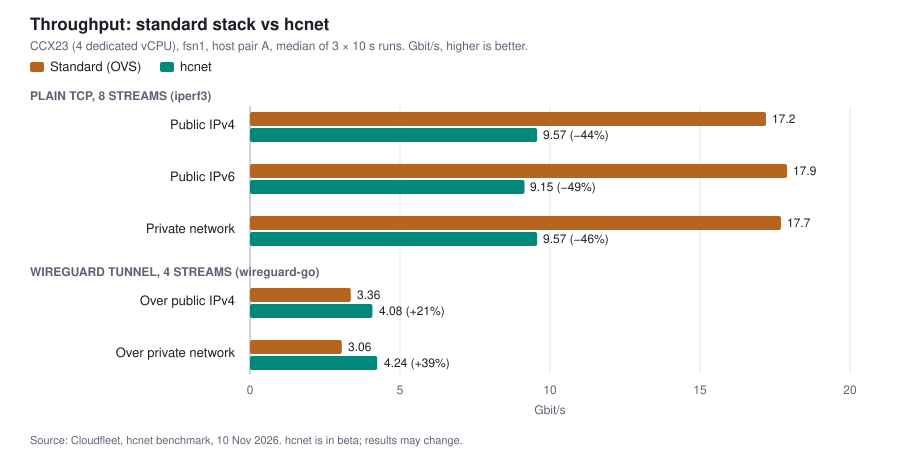
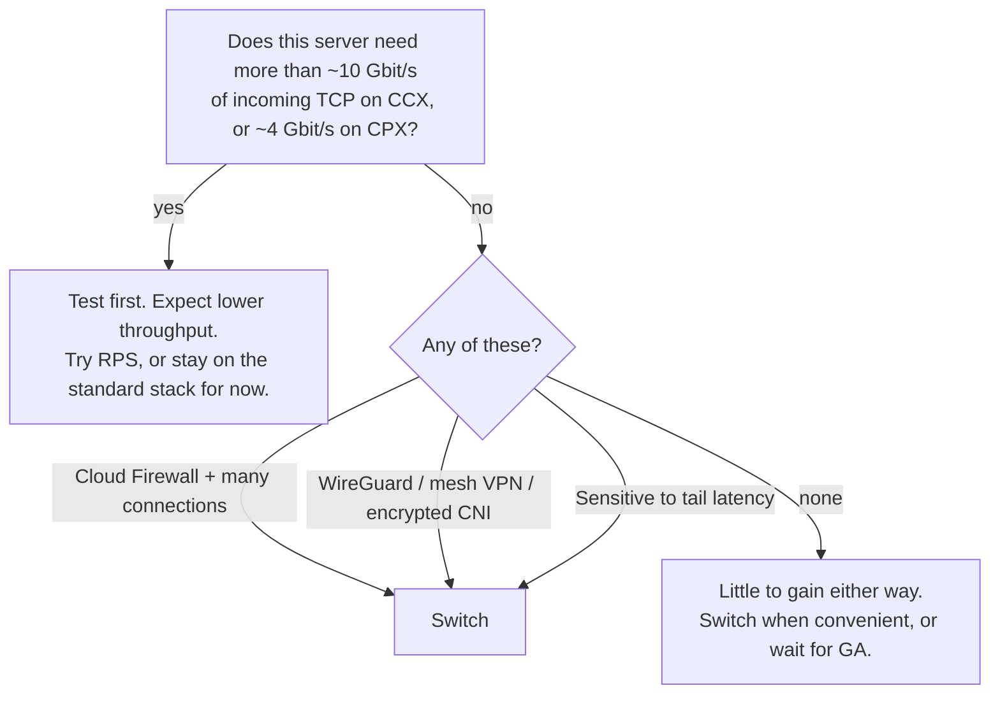

# Performance: what the benchmarks show

Hetzner's docs explain *what* hcnet changes. This page covers *how it performs*, based on the first independent benchmark, published by Cloudfleet on 10 November 2026. Cloudfleet runs thousands of Hetzner servers as Kubernetes nodes.

**Short version:** hcnet is better at almost everything **except one thing: receiving lots of plain TCP traffic on a single server.** There it reaches roughly half the throughput of the standard stack, because one vCPU in your VM has to process every incoming packet.

- [Test setup](#test-setup)
- [Results at a glance](#results-at-a-glance)
- [Why plain TCP throughput drops](#why-plain-tcp-throughput-drops)
- [Why WireGuard gets faster](#why-wireguard-gets-faster)
- [Latency](#latency)
- [Connection tracking, measured](#connection-tracking-measured)
- [Tuning a server on hcnet](#tuning-a-server-on-hcnet)
- [Should you switch?](#should-you-switch)
- [Running your own benchmark](#running-your-own-benchmark)
- [Caveats](#caveats)

---

## Test setup

| | |
|---|---|
| Main servers | 4 × **CCX23** (4 dedicated AMD EPYC Milan vCPU, 16 GB RAM) |
| Shared-vCPU check | 2 × **CPX42** (8 shared AMD EPYC Genoa vCPU) |
| Location | Falkenstein (`fsn1`) |
| OS | Ubuntu 24.04, kernel 6.8 |
| Placement | One *spread* placement group, so every server ran on a different physical host |
| Method | Two host pairs, each measured on the standard stack, switched to hcnet, and measured again |
| Paths | Public IPv4, public IPv6, private network |
| Tools | `iperf3` 3.16 (throughput), `netperf` TCP_RR / TCP_CRR (latency, connection setup), `ping` at 100–200 pps |
| Runs | 3 × 10 seconds per test and stack; medians reported; differences under about 10% treated as noise |

## Results at a glance

| What | Standard | hcnet | Change |
|---|---|---|---|
| Firewall connection limit | ~84,000–88,000 (IPv4+IPv6 shared) | 120,000 **per** IP version | 1.4× for IPv4, up to 2.7× using both |
| Recovery after the table fills | 44–64 s | 0–3 s | ~20× faster |
| WireGuard, 4 streams | 3.1–4.0 Gbit/s | 4.1–4.7 Gbit/s | **+18% to +39%** |
| TCP request/response p99 (public IPv4) | 189–217 µs | 165–172 µs | **−13% to −21%** |
| New-connection p99 (TCP_CRR) | 508–565 µs | 454–474 µs | −10% to −16% |
| TCP, 1 stream | 7.8–9.0 Gbit/s | 7.5–8.8 Gbit/s | no consistent change |
| TCP, 8 streams, CCX23 | 15.6–18.1 Gbit/s | 9.1–10.4 Gbit/s | **−39% to −50%** |
| TCP, 8 streams, CPX42 | 7.5–8.9 Gbit/s | 3.5–4.1 Gbit/s | **about −55%** |



Detailed 8-stream TCP numbers on CCX23 (Gbit/s):

| Path | Pair A std | Pair A hcnet | Pair B std | Pair B hcnet |
|---|---|---|---|---|
| Public IPv4 | 17.2 | 9.57 | 18.1 | 9.87 |
| Public IPv6 | 17.9 | 9.15 | 18.1 | 9.07 |
| Private | 17.7 | 9.57 | 17.5 | 10.3 |

The drop is the same on all three paths, so it isn't caused by the firewall or by VXLAN. It's about how packets are delivered to the VM.

## Why plain TCP throughput drops

The cause is a combination of two things: no merging of packets on the host, and a single receive queue in the VM.

**1. The standard stack merges packets on the host; hcnet doesn't.**

When a TCP stream arrives, the standard stack's host merges consecutive segments (GRO, see [concepts](concepts.md#offloads-gro-tso-and-checksums)) before handing them to the VM. Cloudfleet measured an average of **12–38 KB per packet** arriving at the VM's virtual NIC.

hcnet hands packets over exactly as they came off the wire: **1,514 bytes** on the public interface and **1,464 bytes** on private networks. That is **8–20× more packets** for the same amount of data.

```
Standard stack                           hcnet
wire:  ▮▮▮▮▮▮▮▮▮▮▮▮▮▮▮▮ (1.5 KB each)      wire:  ▮▮▮▮▮▮▮▮▮▮▮▮▮▮▮▮
host:  merges → ███ ███ ███ (12–38 KB)    host:  passes through as-is
VM:    3 packets to process               VM:    16 packets to process
```

### What the numbers mean

For the full trip, hop by hop, from one VM to another, out to the internet and back in, see [a packet's journey](packet-journeys.md).

There are three sizes to explain:

| Size | What it is |
|---|---|
| **1,514 bytes** | One normal packet on the public interface, exactly as it travelled on the wire |
| **1,464 bytes** | One normal packet on a private network. It's 50 bytes smaller because the network needs room for a wrapper. |
| **12–38 KB** | What the standard stack hands your VM: 8–26 of those packets glued into one |

#### 1,514 bytes: one packet on the public interface

Every packet is a stack of headers followed by your data. On the public interface, the IP packet can be at most **1,500 bytes**. That limit is the MTU. Ethernet puts a 14-byte header in front, so the full frame is 1,514 bytes:

```text
┌──────────┬──────────┬──────────┬──────────────────────────────────┐
│ Ethernet │ IPv4     │ TCP      │ your data                        │
│ 14 bytes │ 20 bytes │ 32 bytes │ 1,448 bytes                      │
└──────────┴──────────┴──────────┴──────────────────────────────────┘
           └──────────────── IP packet: 1,500 bytes (the MTU) ──────┘
└──────────────────────── frame: 1,514 bytes ───────────────────────┘
```

The TCP header is 32 bytes and not 20, because Linux adds 12 bytes of timestamps to every segment. Over IPv6, the IP header is 40 bytes, so the data shrinks to 1,428.

So of every 1,514 bytes, 1,448 are your data and 66 are headers.

#### 1,464 bytes: one packet on a private network

Private-network traffic between two hosts travels over the same datacenter network, which also carries at most 1,500-byte IP packets. To keep each customer's traffic separate, the sending host **wraps your whole frame inside another packet** (VXLAN). The receiving host unwraps it again. The wrapper and your frame together must still fit in 1,500 bytes:

```text
What the datacenter network carries (IP packet, at most 1,500 bytes):

┌──────────┬─────────┬─────────┬─────────────────────────────────────────────────┐
│ outer IP │ UDP     │ VXLAN   │ your frame                                      │
│ 20       │ 8       │ 8       │ ┌──────────┬──────────────────────────────────┐ │
│          │         │         │ │ Ethernet │ your IP packet                   │ │
│          │         │         │ │ 14       │ at most 1,450                    │ │
│          │         │         │ └──────────┴──────────────────────────────────┘ │
└──────────┴─────────┴─────────┴─────────────────────────────────────────────────┘
 └──────────── 20 + 8 + 8 + 14 = 50 bytes of overhead ──────────┘

1,500 − 50 = 1,450 → the MTU of your private interface
```

Your VM never sees the wrapper; the receiving host removes it first. What arrives is your frame: 14 bytes of Ethernet plus an IP packet of at most 1,450 bytes, **1,464 bytes** in total. After the 52 bytes of IP and TCP headers, that leaves **1,398 bytes of data** per packet, 50 fewer than on the public interface. See [VXLAN](concepts.md#vxlan) for why the wrapper is there.

#### 12–38 KB: many packets merged into one

A large download doesn't arrive as one piece. The sender cuts it into 1,448-byte chunks, each with its own headers, and numbers each chunk by its byte position in the stream (the TCP *sequence number*):

```text
on the wire:   ┌────┬──────────────┐ ┌────┬──────────────┐ ┌────┬──────────────┐
               │hdrs│ bytes 0–1447 │ │hdrs│ 1448–2895    │ │hdrs│ 2896–4343    │ ...
               └────┴──────────────┘ └────┴──────────────┘ └────┴──────────────┘
                 packet 1              packet 2              packet 3
```

On the **standard stack**, the host collects packets that belong to the same connection and continue exactly where the previous one ended. It keeps the headers of the first, throws away the headers of the rest, and joins the data. It then fixes the length field and hands the result to your VM as **one** packet:

```text
standard:      ┌────┬────────────────────────────────────────────────────────┐
               │hdrs│ bytes 0 – 31,855 (22 chunks of 1,448)                  │  → 1 packet
               └────┴────────────────────────────────────────────────────────┘    ~32 KB

hcnet:         ┌────┬──────┐ ┌────┬──────┐ ┌────┬──────┐       ┌────┬──────┐
               │hdrs│ 1,448│ │hdrs│ 1,448│ │hdrs│ 1,448│  ...  │hdrs│ 1,448│   → 22 packets
               └────┴──────┘ └────┴──────┘ └────┴──────┘       └────┴──────┘    1,514 bytes each
```

The data is identical in both cases: 22 × 1,448 = 31,856 bytes. The difference is how many pieces your VM has to handle: **1 on the standard stack, 22 on hcnet**. Cloudfleet's measured average of 12–38 KB per packet means the standard stack was merging roughly **8 to 26** wire packets into each one. That's where "8–20× more packets on hcnet" comes from. The merge can't go above 64 KB, which is about 45 packets.

This merging is called GRO (generic receive offload); see [concepts](concepts.md#offloads-gro-tso-and-checksums). It only works for a stream of consecutive data.

### Example: receiving at 10 Gbit/s

10 Gbit/s is 1.25 GB of data per second. The stack only affects how many pieces it arrives in:

| | Standard (average 25 KB) | hcnet (1,514 bytes) |
|---|---|---|
| Packets per second into the VM | ~50,000 | ~826,000 |
| Packets to receive a 1 GB file | ~40,000 | ~690,000 |
| Time per packet on one 3 GHz vCPU, if it is to keep up | ~20 µs | **~1.2 µs** (~3,600 CPU cycles) |

Each packet costs a fixed amount of work, however small it is. The VM has to take it from the virtual NIC, allocate a buffer, check the headers, try to merge it, run TCP and wake the application. 3,600 cycles for all of that leaves almost no headroom. That's why the receiving vCPU sat at 93–97% softirq at around 10 Gbit/s, while the standard stack reached 17 Gbit/s.

Think of it as a delivery that comes either as a few pallets or as hundreds of loose parcels. The weight is the same, but whoever unloads has to pick up each piece separately.

**The work moves; it doesn't disappear.** On hcnet, the VM's own GRO still merges the packets before TCP sees them. But now that merging happens on the VM's single receive vCPU, instead of on the host's many cores.

**Small packets aren't affected.** Requests, responses, DNS and SSH are often smaller than one frame anyway, so there's nothing to merge on either stack. The difference only shows up with long transfers: downloads to the server, backups, replication and bulk ingest.

### See it on your server

Divide received bytes by received packets over a few seconds of heavy inbound traffic, for example while running `iperf3 -c <this server> -R`:

```console
$ IF=eth0
$ b1=$(cat /sys/class/net/$IF/statistics/rx_bytes); p1=$(cat /sys/class/net/$IF/statistics/rx_packets)
$ sleep 10
$ b2=$(cat /sys/class/net/$IF/statistics/rx_bytes); p2=$(cat /sys/class/net/$IF/statistics/rx_packets)
$ echo "average: $(( (b2-b1)/(p2-p1) )) bytes/packet, $(( (p2-p1)/10 )) packets/s"
average: 24817 bytes/packet, 47210 packets/s     # standard stack
average: 1512 bytes/packet, 801344 packets/s     # hcnet
```

The output lines are illustrative. The interface counters count what the virtual NIC delivered, before the VM's own GRO. `tcpdump` inside the VM runs *after* GRO, so it shows large merged packets on both stacks and isn't a good way to compare them.

**2. The VM has one receive queue, so one vCPU does all the work.**

On these server types, the virtio NIC has a **single receive queue**. Every incoming packet raises an interrupt on the same vCPU, and that vCPU processes the packet in *softirq* context. With 8–20× more packets, that one vCPU becomes the bottleneck:

- On hcnet, the receiving vCPU sat at **93–97% softirq** during 8-stream tests. The other vCPUs were mostly idle.
- On the sending side, the busiest vCPU stayed **over 60% idle**, so sending is not the problem.
- In a bidirectional test, hcnet *receivers* topped out at **8.5–11.6 Gbit/s** whichever stack the sender used. Standard receivers reached **15–18.6 Gbit/s**, even when the sender was on hcnet.

So the limit is on the **receive side of the hcnet server**. A server that mostly *sends* (for example, a web server serving downloads) is affected much less than one that mostly *receives* (an ingest node, a backup target, a database replica).

On shared-vCPU servers (CPX), the receiving vCPU is weaker and shared, so the effect is stronger: on CPX42 a **single** stream already pushed the receiving vCPU to 89% softirq and dropped from ~6.1 to ~5.4 Gbit/s.

**Check your server's queue count:**

```console
$ ethtool -l eth0
Channel parameters for eth0:
Pre-set maximums:
Combined:       1
Current hardware settings:
Combined:       1        ← one queue: all receive work lands on one vCPU
```

**Watch softirq load while traffic is flowing:**

```console
$ mpstat -P ALL 1          # from the sysstat package; look at the %soft column
CPU   %usr  %sys  %soft  %idle
  0    1.0   3.0   95.0    1.0   ← the receive vCPU is saturated
  1    2.0   1.0    0.0   97.0
  ...
```

Cloudfleet suggests that Hetzner add **multi-queue virtio NICs**, which would spread receive work across vCPUs and remove this bottleneck.

## Why WireGuard gets faster

WireGuard tunnels got **18–39% faster** on hcnet:

| Test (wireguard-go, Gbit/s) | Pair A std | Pair A hcnet | Pair B std | Pair B hcnet |
|---|---|---|---|---|
| 4 streams, public IPv4 | 3.36 | 4.08 | 3.95 | 4.65 |
| 4 streams, private | 3.06 | 4.24 | 3.80 | 4.48 |
| 4 streams reverse, public IPv4 | 3.55 | 4.92 | 3.33 | 4.32 |
| 1 stream, public IPv4 | 3.21 | 4.39 | 3.93 | 4.36 |

Encryption is the bottleneck for WireGuard, so tunnels never get close to the ~10 Gbit/s single-queue ceiling. Within that range, hcnet's shorter, simpler host path helps. WireGuard traffic is UDP, and the host couldn't merge it the way it merges TCP anyway, so hcnet doesn't lose anything here.

This matters for Kubernetes clusters and mesh VPNs (Tailscale, Netbird, Cilium/Calico with WireGuard encryption), where node-to-node traffic is tunnelled.

## Latency

hcnet is slightly faster at the median and noticeably better in the tail:

| Measurement | Standard | hcnet |
|---|---|---|
| Median TCP_RR, public IPv4 | 115–135 µs | 6–7% lower |
| p99 TCP_RR, pair A | 217 µs | 172 µs |
| p99 TCP_RR, pair B | 189 µs | 165 µs |
| p99 TCP_CRR (new connection), pair A | 565 µs | 474 µs |
| p99 TCP_CRR, pair B | 508 µs | 454 µs |
| Median TCP_RR, private, pair A | 75 µs | 68 µs |
| Median TCP_RR, private, pair B | 137 µs | 126 µs |
| Ping to gateway `172.31.1.1` | 1.3 ms | **0.1 ms** |

Notes:

- **Placement matters more than the stack** on private networks: pair A and pair B differ by almost 2× on either stack. If latency between two servers matters, look at where they run before looking at the stack.
- The gateway responds about 13× faster because hcnet answers it directly on the host, and `traceroute` shows **one hop fewer**.
- New connections per second rose 23% on one pair and stayed flat on the other.

Tail latency (p99) is what users notice in request-heavy services, such as APIs behind a load balancer or chatty microservices.

## Connection tracking, measured

Cloudfleet filled the firewall's connection table on purpose:

| Test | Standard | hcnet |
|---|---|---|
| IPv4 + IPv6 together | ~88,000 total (45,819 IPv4 + 42,000 IPv6) | 119,992 IPv4 **and** 120,000 IPv6 |
| IPv4 only | 83,998 | 119,994 |
| Allow-all firewall, 160,000 connections attempted | Stopped at ~86,000, new connections dropped | All 160,000 accepted |
| Time to recover after the table filled | 44–64 s | 0–3 s |
| SSH while the table was full | **Server unreachable** | Reachable |

What this shows:

- The real limit on the standard stack is a bit **above** the documented 80,000 (84k–88k). Plan for 80,000 anyway.
- On hcnet, the IPv4 and IPv6 limits really are independent.
- The allow-all test confirms the behaviour from the docs: when the table is full, hcnet stops tracking and checks rules only. With an allow-all firewall, every connection gets through.
- On the standard stack, a full table locks you out of SSH too. That makes it an outage, not just a slowdown. Keep the Console's web console in mind as your way in.
- Recovery is about 20× faster on hcnet, so a spike causes a blip instead of a minute-long outage.

See [Connection tracking in practice](conntrack-in-practice.md) for how to measure your own usage.

## Tuning a server on hcnet

If you switch a server that receives a lot of TCP traffic, these settings can claw back some throughput.

**Spread receive processing across vCPUs with RPS** (Receive Packet Steering). RPS lets the kernel hand packets from the single queue to other vCPUs for processing:

```bash
# 4 vCPUs → bitmask f (binary 1111). For 8 vCPUs use ff.
echo f | sudo tee /sys/class/net/eth0/queues/rx-0/rps_cpus
echo f | sudo tee /sys/class/net/ens10/queues/rx-0/rps_cpus   # private interface, if any

# Optional: RFS keeps a flow on the vCPU where its application runs
echo 32768 | sudo tee /proc/sys/net/core/rps_sock_flow_entries
echo 32768 | sudo tee /sys/class/net/eth0/queues/rx-0/rps_flow_cnt
```

In Cloudfleet's test, RPS on four vCPUs lifted hcnet's 8-stream throughput to **~11.5 Gbit/s**, up from ~9.5 Gbit/s. That's still below the standard stack's ~17 Gbit/s, and the receive vCPU still sat at 88% softirq.

These settings don't survive a reboot. To make them persistent, use a udev rule:

```bash
# /etc/udev/rules.d/60-rps.rules
SUBSYSTEM=="net", ACTION=="add", KERNEL=="eth0|ens10", RUN+="/bin/sh -c 'echo f > /sys/class/net/%k/queues/rx-0/rps_cpus'"
```

**Keep GRO on.** Disabling GRO inside the VM dropped throughput further, to about 10 Gbit/s with RPS. Check that it's enabled:

```console
$ ethtool -k eth0 | grep generic-receive-offload
generic-receive-offload: on
```

**Use parallel servers instead of one big one.** Since the limit is per receiving vCPU, two CCX23s behind a load balancer each get their own ~10 Gbit/s ceiling.

## Should you switch?



| Workload | Recommendation |
|---|---|
| Ingress controller / reverse proxy with a Cloud Firewall | **Switch.** More connection headroom, better p99, faster recovery |
| Load-balancer backends | **Switch.** Each backend's inbound traffic is usually well under 10 Gbit/s |
| Kubernetes nodes with WireGuard encryption (Cilium, Calico) or Tailscale/Netbird | **Switch.** +18–39% tunnel throughput |
| Latency-sensitive APIs and microservices | **Switch.** p99 drops 13–21% |
| Backup targets, ingest nodes, database replicas receiving bulk TCP | **Test first.** Throughput may roughly halve |
| Storage or file servers on CPX (shared vCPU) | **Test first.** The drop is largest on shared vCPUs |
| Small servers with no Cloud Firewall | Little difference either way |

## Running your own benchmark

Results depend on server type, location and host placement, so test your own setup. A minimal version of Cloudfleet's method:

```bash
# On both servers
sudo apt install -y iperf3 netperf sysstat

# Receiver (the server you plan to switch)
iperf3 -s

# Sender: 1 stream and 8 streams, 10 s each, 3 runs
for p in 1 8; do for i in 1 2 3; do
  iperf3 -c <receiver-ip> -P $p -t 10 -J | jq '.end.sum_received.bits_per_second / 1e9'
done; done

# Latency and connection setup (receiver runs: netserver)
netperf -H <receiver-ip> -t TCP_RR  -l 10 -- -o P50_LATENCY,P99_LATENCY
netperf -H <receiver-ip> -t TCP_CRR -l 10 -- -o P50_LATENCY,P99_LATENCY

# In another terminal on the receiver, watch for one vCPU at ~100% %soft
mpstat -P ALL 1
```

Then switch the receiver to hcnet (see the [switching guide](switching-guide.md)), renew DHCP, and run the same commands again. Use a **spread placement group** so the two servers aren't on the same host. Otherwise you are measuring the host's internal path, not the network.

## Caveats

- **hcnet is in beta.** Hetzner may change its behaviour and performance before general availability, possibly including the multi-queue NICs that would fix the receive bottleneck.
- **One location (`fsn1`), two server types (CCX23, CPX42), no Arm (CAX).** Other types may behave differently.
- **Short tests** (10 s), **two host pairs**. Differences under ~10% are treated as noise.
- UDP packet rate and connection-rate results were left out of the article because they varied too much between host pairs.
- Kubernetes CNIs (Cilium, Calico) and HTTP-level load (`wrk`, `k6`) were not tested directly.

## Source

- Cloudfleet, [benchmark of Hetzner's new network stack (hcnet)](https://cloudfleet.ai/blog/cloud-native-how-to/2026-11-hetzner-new-network-stack-benchmark/), 10 November 2026.
