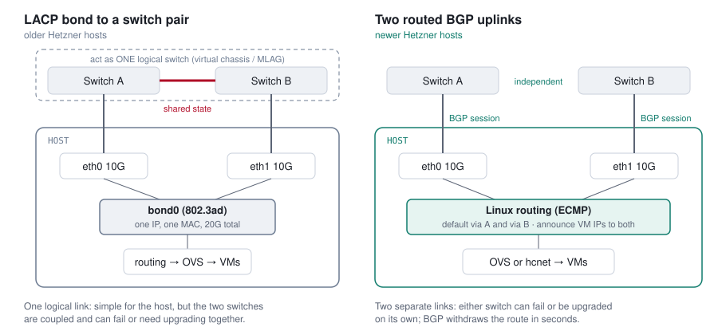

# Bond interfaces and host uplinks

A **bond** is how Hetzner's older cloud hosts connect to the datacenter: two physical 10 Gb/s ports combined into one logical interface. This page explains what a bond is, why clouds use one, and why Hetzner is moving its hosts to two separately routed BGP uplinks instead.

- [What a bond is](#what-a-bond-is)
- [Bonding modes](#bonding-modes)
- [LACP (802.3ad) in detail](#lacp-8023ad-in-detail)
- [Hashing: why one connection never gets 20 Gb/s](#hashing-why-one-connection-never-gets-20-gbs)
- [Bonding to two switches: MLAG and virtual chassis](#bonding-to-two-switches-mlag-and-virtual-chassis)
- [Why cloud hosts use bonds](#why-cloud-hosts-use-bonds)
- [How Hetzner uses them, and why it's moving away](#how-hetzner-uses-them-and-why-its-moving-away)
- [Bond vs BGP uplinks](#bond-vs-bgp-uplinks)
- [What this means for your cloud server](#what-this-means-for-your-cloud-server)
- [Inside the kernel: a packet through bond0](#inside-the-kernel-a-packet-through-bond0)
- [Hands-on: build and inspect a bond](#hands-on-build-and-inspect-a-bond)
- [Verified in a lab](#verified-in-a-lab)

---

## What a bond is

A **bond** (also called link aggregation, a LAG, a port channel or NIC teaming) is a virtual network interface that combines several physical interfaces. The rest of the system sees one interface, usually named `bond0`, with one MAC address and one IP address.

```
        applications / routing / bridges
                     │
               ┌─────┴─────┐
               │   bond0   │   one IP, one MAC
               └──┬─────┬──┘
                  │     │      the bonding driver chooses
              ┌───┴─┐ ┌─┴───┐  which port each packet uses
              │eth0 │ │eth1 │
              └──┬──┘ └──┬──┘
                 │       │     two cables
             ┌───┴───────┴───┐
             │    switch(es) │
             └───────────────┘
```

A bond gives you two things:

1. **Redundancy.** If one cable, port or network card fails, traffic continues over the remaining ports. The IP address doesn't change, so nothing above the bond notices.
2. **More total bandwidth.** With two 10 Gb/s ports, the bond can carry up to 20 Gb/s in total. That only applies across many connections at once (see [hashing](#hashing-why-one-connection-never-gets-20-gbs)).

On Linux, bonding is a kernel driver (`bonding`). On Windows it's called NIC Teaming, and switches call the same thing a *port channel*, *LAG* or *trunk*.

## Bonding modes

The Linux bonding driver has seven modes. They differ in whether the ports are active at the same time, and whether the switch needs to be configured to match.

| Mode | Name | Ports active | Switch config needed | Typical use |
|---|---|---|---|---|
| 0 | `balance-rr` | All, packets alternate | Yes (static LAG) | Rare: reorders packets within a TCP stream |
| 1 | `active-backup` | One; the other waits | **No** | Simple failover, works with any switch |
| 2 | `balance-xor` | All, chosen by hash | Yes (static LAG) | Load sharing without LACP |
| 3 | `broadcast` | All, every packet on every port | Yes | Special cases only |
| 4 | **`802.3ad`** (LACP) | All, chosen by hash | **Yes (LACP)** | **The datacenter standard**, used by Hetzner hosts |
| 5 | `balance-tlb` | All for sending, one for receiving | No | Load sharing with dumb switches |
| 6 | `balance-alb` | All, using ARP tricks for receiving | No | Same, plus receive balancing (IPv4 only) |

In datacenters, the only modes you normally see are **mode 4 (LACP)** for redundancy plus bandwidth, and **mode 1 (active-backup)** where the switch can't be configured.

## LACP (802.3ad) in detail

**LACP** (Link Aggregation Control Protocol, IEEE 802.3ad, now 802.1AX) is a small protocol that runs between the host and the switch. Both ends send LACPDUs (control frames) on each port, every second (`fast`) or every 30 seconds (`slow`). Through them they:

- **agree which ports belong together**, so a mis-cabled port doesn't join by mistake
- **detect a failed link** even when the cable still shows "link up", for example a port stuck on the switch side
- **only send traffic on ports that both sides have accepted**

Without LACP (a *static* LAG, modes 0 and 2), the host only checks whether the cable has link. A port that is up but broken keeps receiving traffic, which is silently lost.

Failure detection timing:

| Mechanism | How it notices | Time to fail over |
|---|---|---|
| Carrier (`miimon=100`) | Cable or link goes down | ~100 ms |
| LACP, `lacp_rate=fast` | 3 missed LACPDUs at 1 s | ~3 s |
| LACP, `lacp_rate=slow` | 3 missed LACPDUs at 30 s | ~90 s |

## Hashing: why one connection never gets 20 Gb/s

A bond can't split one connection across both ports. Doing so would deliver packets out of order, which TCP treats as loss and slows down for. Instead, the bond computes a **hash** of each packet's headers and uses it to pick a port. Every packet of the same flow gets the same hash, so it always takes the same port.

The `xmit_hash_policy` setting decides which headers go into the hash:

| Policy | Hashes over | Effect |
|---|---|---|
| `layer2` (default) | Source and destination MAC | All traffic to the same router uses **one port**, which is bad for a host behind a gateway |
| `layer2+3` | MACs + IP addresses | Different peers spread out; all connections to one peer share a port |
| `layer3+4` | IP addresses + **ports** | Every TCP/UDP connection hashes separately. **The usual choice on servers** |
| `encap3+4` | Inner headers of tunnels (VXLAN etc.) | Spreads tunnelled traffic that would otherwise look like one flow |

Example with `layer3+4` on a host with two 10G ports:

```
flow                                   hash → port
203.0.113.7:443 ↔ 198.51.100.20:51544  → eth0
203.0.113.7:443 ↔ 198.51.100.21:40112  → eth1
203.0.113.8:22  ↔ 198.51.100.99:60000  → eth0
...
```

Consequences:

- **One flow is limited to one port's speed.** A single `iperf3` stream can't exceed 10 Gb/s on a 2×10G bond.
- **Many flows spread out** and can use the full 20 Gb/s, roughly.
- **Balance is statistical.** A few very large flows can land on the same port by chance and leave the other underused.
- **Each side hashes its own sending direction.** The host decides which port its outgoing packets use. The switch decides which port incoming packets arrive on, using its own hash.

This is a good fit for a cloud host: hundreds of VMs produce thousands of flows, so the hash spreads them well.

Note that the single-stream throughput of 7.8–9.0 Gb/s in the [benchmarks](benchmarks.md) is consistent with one flow staying on one 10G link. The benchmark doesn't say which uplink type those hosts used.

## Bonding to two switches: MLAG and virtual chassis

If both cables of a bond go to **the same switch**, a cable or port can fail but the switch is still a single point of failure.

To survive a whole switch failing, you connect one cable to each of **two switches**. LACP expects both ports to lead to the same device, so the two switches must pretend to be one. Vendors call this:

- **MLAG** (Multi-Chassis Link Aggregation), **vPC** (Cisco), **MC-LAG** (Juniper and others)
- **Virtual chassis / stacking**: the two switches are managed as one, with a shared control plane

The switches are joined by an inter-switch link and keep their state in sync: which MAC addresses live where and which LACP partners exist. The host just sees one LACP partner.

**The drawback is shared fate.** The two switches are no longer independent:

- A software bug or a bad configuration change can affect both at once.
- Upgrading the switch firmware can require taking both down, or a carefully choreographed upgrade.
- If the inter-switch link fails, the pair can disagree about which side is active (a *split-brain*).
- The features you get depend on what that switch vendor supports.

The Hetzner blog describes exactly this setup: **two 10 Gb/s interfaces in an LACP bond, connected to two switches forming a virtual chassis.**

## Why cloud hosts use bonds

A cloud host runs dozens or hundreds of VMs. Its uplink is a single point of failure for all of them, and their traffic adds up. A bond addresses both problems with very little complexity:

| Need | How a bond helps |
|---|---|
| Survive a cable, optic, port or NIC failure | Traffic moves to the other port within ~100 ms, invisibly to VMs |
| Survive a switch failure | Use MLAG / virtual chassis across two switches |
| More bandwidth than one port | Thousands of VM flows hash across both ports |
| Simple host config | One interface, one IP, one default route. No routing protocol on the host |
| Maintenance | Take one switch port or cable down for work without moving VMs |

## How Hetzner uses them, and why it's moving away

From the Hetzner blog:

- **2015–2016:** the Ceph-based cloud already used BGP routing in the network. Host links were upgraded to **2×10 Gb/s** in 2016.
- **Hetzner Cloud with OVS:** most hosts use **two 10 Gb/s interfaces bundled as an LACP bond**, connected to **two switches forming a virtual chassis**.
- **Now:** Hetzner is migrating hosts to **two native BGP-routed uplinks on independent switches**.

The reasons fit Hetzner's general approach: keep the network simple, avoid depending on vendor features, and keep failures contained.

- **Independent switches.** No virtual chassis means no shared control plane. A bug, misconfiguration or upgrade affects only one switch.
- **No vendor lock-in.** BGP is a standard every router speaks. MLAG and virtual chassis are proprietary and differ between vendors.
- **Routing, not bridging.** Each uplink is a separate routed link. The host announces its VMs' addresses over BGP, and the network picks paths by routing, not by MAC learning across a switch pair.
- **IP mobility.** When a VM or Floating IP moves to another host, the new host announces the route and the network converges.

## Bond vs BGP uplinks



| | LACP bond (older hosts) | BGP-routed uplinks (newer hosts) |
|---|---|---|
| Interfaces on the host | `bond0` over `eth0` + `eth1` | `eth0` and `eth1`, each with its own address |
| Host IP | One, on `bond0` | One per uplink, plus addresses announced via BGP |
| Switches | Two, joined as one (MLAG / virtual chassis) | Two, **independent** |
| Load sharing | Per-flow hash in the bonding driver | Per-flow hash by ECMP (Equal-Cost Multi-Path) routing |
| Failure detection | Carrier + LACP (100 ms – 3 s) | Carrier + BGP, often with BFD for sub-second detection |
| Host software | Kernel bonding driver | A BGP daemon (for example BIRD or FRR) |
| Switch requirements | MLAG / virtual chassis support | Plain BGP |
| Blast radius of a switch bug | Can take out both switches | One switch |

Load sharing works the same way in both: one flow sticks to one link, and many flows spread out. With BGP, the hash happens in the kernel's routing table instead of the bonding driver:

```console
$ ip route show default        # BGP host: two next hops, ECMP
default proto bgp metric 20
        nexthop via 10.1.0.1 dev eth0 weight 1
        nexthop via 10.1.1.1 dev eth1 weight 1
```

With `net.ipv4.fib_multipath_hash_policy=1`, the kernel hashes on ports too, which corresponds to `layer3+4` in bonding.

The two-uplink layout and the use of BGP come from Hetzner's blog. The example addresses, the choice of BIRD or FRR, and BFD are typical of such designs; Hetzner hasn't published those details.

## What this means for your cloud server

**Your cloud server doesn't need, and can't usefully have, a bond.** It has one virtual NIC per network (`eth0` public, `ens10` and so on for private networks). Redundancy happens below it, on the host:

```
your VM:      eth0 (virtio) ─────┐
                                 │  single virtual link, can't fail independently
host:         OVS / hcnet ◄──────┘
                    │
              routing on the host
                    │
uplinks:      bond0 (eth0+eth1)   or   eth0 + eth1 with BGP
                    │                        │
              switch pair              two independent switches
```

What you may notice:

- **A switch or cable failure on the host** is normally invisible. At worst, a few connections see packet loss for a moment during failover.
- **Single-flow throughput** is capped by one physical uplink (10 Gb/s), whatever the host's total uplink capacity.
- **Your VM shares the uplinks** with the other VMs on the same host.
- **For redundancy against a whole host failing**, use several servers in a spread placement group behind a Load Balancer, or a Floating IP you move between servers. A bond inside one VM can't protect against that.

Where you *do* configure bonds yourself is on **dedicated (bare-metal) servers** with more than one network port, or with on-premises hardware. The [hands-on section](#hands-on-build-and-inspect-a-bond) shows how.

## Inside the kernel: a packet through bond0

At the kernel level, `bond0` is a virtual `net_device` created by the bonding driver. The physical interfaces become its *slaves* (newer docs say *ports*). The key idea is that **the bond swaps the device pointer at the boundary between layer 2 and layer 3**:

- Everything **below** the swap (the NIC driver, native XDP, GRO, `tcpdump -i eth0`) sees the physical interface.
- Everything **above** it (IP routing, Netfilter, conntrack, sockets) sees only `bond0`.

```
              sockets / TCP / UDP
                      │
        IP stack + Netfilter + conntrack      ← sees only bond0
                      │
   ───────────── skb->dev swap ─────────────   bond_handle_frame (in)
                      │                        bond xmit + hash (out)
          ┌───────────┴───────────┐
       eth0                     eth1          ← driver, GRO, native XDP,
     (driver)                 (driver)          tcpdump -i eth0
```

> Function names and behaviour in this section were checked against the Linux **6.19-rc8** source tree. Paths are relative to the kernel source root. Names can change between versions, so look up the function name rather than a line number.

### Receiving (ingress)

The core of the receive path is a loop in `__netif_receive_skb_core()` (`net/core/dev.c`). Each pass through it starts at the label `another_round`. A bonded frame goes through the loop **twice**: once as `eth0`, then again as `bond0`.

```
another_round:                          pass 1: skb->dev = eth0     pass 2: skb->dev = bond0
  skb->skb_iif = skb->dev->ifindex      eth0's ifindex              bond0's ifindex
  generic XDP (if attached, skb mode)   eth0's program              bond0's program
  packet taps (ptype_all)               tcpdump -i eth0             tcpdump -i bond0
  tc ingress / nft netdev ingress       eth0's hooks                bond0's hooks
  rx_handler                            bond_handle_frame()         (none) → continue
                                        → RX_HANDLER_ANOTHER        → IP stack
```

1. **Driver and native XDP.** A frame arrives on `eth0`. If a **native XDP** program is attached, the driver runs it on the raw buffer *before* any `sk_buff` exists. Otherwise the driver builds an `sk_buff` with `skb->dev = eth0`.
2. **GRO.** The driver's NAPI poll passes the `sk_buff` to `napi_gro_receive()`, which may merge consecutive TCP segments. That is still on `eth0`. `virtio_net`, the NIC inside a Hetzner cloud server, does this in `drivers/net/virtio_net.c`. It is also the merging that the Hetzner host does on the standard stack and skips on hcnet (see [benchmarks](benchmarks.md#why-plain-tcp-throughput-drops)).
3. **Pass 1 as `eth0`.** Generic XDP, packet taps (`tcpdump -i eth0`), `tc` ingress programs and nftables `netdev` ingress hooks attached to `eth0` all run here. They see the port, not the bond.
4. **`rx_handler`.** Enslaving `eth0` registered `bond_handle_frame()` (`drivers/net/bonding/bond_main.c`) as its `rx_handler`. It does three things:
   - **Mode-specific probes.** In 802.3ad mode, `bond->recv_probe` is `bond_3ad_lacpdu_recv()`. For LACPDUs and Marker frames it returns `RX_HANDLER_CONSUMED`, so they never reach the IP stack.
   - **Frames on an inactive port** (for example the backup in `active-backup` mode) are **not dropped outright**. The handler returns `RX_HANDLER_EXACT`, so the frame is only delivered to sockets bound to *that exact* port, and is otherwise discarded. Link-local frames such as LLDP get `RX_HANDLER_PASS`, so monitoring daemons can still see an inactive link.
   - **Everything else** gets `skb->dev = bond->dev`, and the handler returns `RX_HANDLER_ANOTHER`.
5. **Pass 2 as `bond0`.** `RX_HANDLER_ANOTHER` jumps back to `another_round`. `skb->skb_iif` becomes `bond0`'s ifindex, and taps and hooks on `bond0` run. The original port is still remembered as `orig_dev`, which a packet socket can read with the `PACKET_ORIGDEV` option.
6. **IP and conntrack.** `ip_rcv()` runs the `NF_INET_PRE_ROUTING` hook. Conntrack's hook there is `ipv4_conntrack_in()` (`net/netfilter/nf_conntrack_proto.c`), which calls `nf_conntrack_in()` (`net/netfilter/nf_conntrack_core.c`). It builds the tuple and looks it up in the hash table.
7. **New connection.** If there is no entry, conntrack allocates an `nf_conn` in the *unconfirmed* state. `ipv4_confirm()` inserts it into the hash table only when the packet reaches the `NF_INET_LOCAL_IN` or `NF_INET_POST_ROUTING` hook. A packet dropped by a filter rule never creates a permanent entry.

**The conntrack entry has no interface in it.** `struct nf_conntrack_tuple` (`include/net/netfilter/nf_conntrack_tuple.h`) holds:

| Part | Fields |
|---|---|
| `src` | address, port (or ICMP ID), L3 protocol |
| `dst` | address, port (or ICMP type and code), L4 protocol, direction |

The **zone** is stored in `struct nf_conn` and mixed into the hash together with the network namespace (`hash_conntrack_raw()`). Neither the tuple nor `nf_conn` has an ifindex. So an entry isn't "attached to bond0". Interfaces only matter to *rules* (`iptables -i bond0`, `nft iifname "bond0"`), and those see `bond0` because of the pointer swap.

### Sending (egress)

1. **Netfilter and conntrack.** A locally generated packet hits `NF_INET_LOCAL_OUT` (`ipv4_conntrack_local()` → `nf_conntrack_in()`), then `NF_INET_POST_ROUTING`, where `ipv4_confirm()` confirms a new entry. The output device is `bond0`.
2. **State.** `nf_conntrack_in()` sets the packet's state (`ctinfo`) like this:
   - A packet in the **reply** direction gets `IP_CT_ESTABLISHED_REPLY`, and conntrack sets `IPS_SEEN_REPLY` on the entry.
   - A packet in the **original** direction gets `IP_CT_ESTABLISHED` only once `IPS_SEEN_REPLY` is set, `IP_CT_RELATED` if the entry was expected, and `IP_CT_NEW` otherwise.

   So sending more packets doesn't make a connection established. **Seeing a reply does.** (TCP has its own, more detailed state machine on top.)
3. **Bond transmit.** The IP stack calls `bond0`'s `ndo_start_xmit`, `bond_start_xmit()`. `__bond_start_xmit()` dispatches on the mode. 802.3ad and XOR modes go to `bond_3ad_xor_xmit()`. In 802.3ad mode with the newer `broadcast_neighbor` option, ARP and IPv6 neighbor discovery are sent on all ports instead.
4. **Choosing a port.** `bond_xmit_3ad_xor_slave_get()` computes `bond_xmit_hash(bond, skb)` and picks `slaves->arr[hash % count]` from the usable ports. With `encap3+4`, the hash already computed for the packet (`skb->hash`) is reused when it covers layer 4.
5. **Device swap.** `bond_dev_queue_xmit()` sets `skb->dev = slave_dev` and calls `dev_queue_xmit()`. The **port's** queueing discipline and hardware queue handle the frame. The bond device is created with `IFF_NO_QUEUE`, so `bond0` itself has no queue (`noqueue`).

### Why conntrack doesn't care about the bond

Conntrack identifies flows by addresses and ports, never by interface. So it doesn't matter which port a frame used, or that requests leave on `eth1` while replies arrive on `eth0`. This also holds when there is **no bond at all**, as on Hetzner's newer [BGP/ECMP hosts](#bond-vs-bgp-uplinks).

What *can* break with two separate uplinks is everything that looks at interfaces:

| Feature | Bond | Two routed uplinks (ECMP) |
|---|---|---|
| Conntrack entries | Fine | Fine: no interface in the tuple |
| Rules like `-i eth0` / `iifname "eth0"` | Match `bond0` instead | A reply arriving on `eth1` won't match. Use an interface group or set (`iifname { "eth0", "eth1" }`) |
| Reverse-path filter (`rp_filter=1`, strict) | Fine | Can drop packets that arrive on a different uplink than the route back. Use `rp_filter=2` (loose) |
| `tcpdump` | On `bond0` you see everything; on `eth0` only that port | Capture on both interfaces (`-i any`) |

This is one reason hcnet attaches each firewall "in front of the server's virtual NIC", at the VM's own interface on the host, not at the uplinks. The firewall is the same whichever uplink, bond or not, the traffic used.

### XDP and bonds

**Native XDP** runs inside the NIC driver, before an `sk_buff` is allocated, before GRO, and before the bonding `rx_handler`. That's why it's so cheap for dropping DDoS traffic. A dropped frame never costs:

- an `sk_buff` allocation
- the `skb->dev` swap and the second pass through the receive loop
- Netfilter hooks and the `nf_conntrack_hash` lookup
- a conntrack entry. A flood of new connections can't fill the table if it's dropped first.

There are two ways to use it with a bond:

| | XDP on each port (`eth0`, `eth1`) | XDP on `bond0` (added in Linux 5.15) |
|---|---|---|
| How | Attach the program to every physical port separately | Attach once to `bond0`. `bond_xdp_set()` pushes it to every port with `dev_xdp_propagate()` |
| What the program sees | Raw frames of that one port. It knows nothing about `bond0` | Same raw frames, still run in each port's driver |
| Requirements | Native XDP in each port's driver | Mode passes `bond_xdp_check()`: `balance-rr`, `active-backup`, `balance-xor` or `802.3ad`, and not the `vlan+srcmac` hash policy. Every port's driver must implement `ndo_bpf` and `ndo_xdp_xmit`, and no port may have its own XDP program already |
| Pitfall | Forget one port and attackers come in through the other. A port added later has no program | Fails with `EOPNOTSUPP` if any port lacks native XDP. `ip link show` lists the program **only on `bond0`**, not on the ports, even though it runs there |
| `XDP_TX` | Goes out of the port it came in on | Rewritten by `xdp_master_redirect()` (`net/core/filter.c`). The bond's `bond_xdp_get_xmit_slave()` picks the output port with the same hash policy as normal traffic, and the frame is redirected there if that's a different port |

```bash
# Attach to the bond (kernel 5.15+); installs on every port
sudo ip link set dev bond0 xdpdrv obj ddos_filter.o sec xdp

# See where XDP and tc programs are attached
sudo bpftool net show
```

What the lab showed (veth ports, kernel 7.0, see [lab results](#verified-in-a-lab)):

- Attaching to `bond0` in 802.3ad mode works. `ip link show bond0` shows `prog/xdp id …`, but `ip link show l0` and `l1` show nothing.
- The program still runs on the ports: an `XDP_DROP` program on `bond0` stopped all traffic, and pings resumed as soon as it was detached.
- Frames dropped by XDP don't appear in the `dropped` counter of `ip -s link`. Count drops inside the program, with a BPF map, if you need them.
- In `balance-alb` mode the kernel refuses with `Error: No native XDP support for the current bonding mode.`
- A port that already has its own XDP program **can** still be enslaved. The error only appears when you attach to the bond: `Error: Slave has XDP program loaded, please unload before enslaving.`

Two caveats:

- **Generic XDP** (`xdpgeneric`, used when a driver lacks native support) runs in `__netif_receive_skb_core()` via `do_xdp_generic()`, *after* the `sk_buff` is allocated and GRO has run. It's the first step of each loop pass, so a program on `eth0` still runs before the bonding `rx_handler`, but most of the speed advantage is gone.
- **`tc` and nftables `netdev` ingress** on a port also run before the bond's `rx_handler` (pass 1). They see the port and can drop traffic before conntrack, at the cost of an `sk_buff` that XDP would have avoided.
- **Inside a Hetzner cloud server**, you can attach XDP to your virtio `eth0`, but by then the packet has already passed through the host, including any Cloud Firewall. That protects your VM's CPU, not its connection table on the host.

### Seeing it on a real machine

```bash
# Conntrack entries carry no interface
sudo conntrack -L -p tcp --dport 22
# tcp 6 431999 ESTABLISHED src=198.51.100.20 dst=203.0.113.10 sport=51544 dport=22 ... [ASSURED]

# The rx_handler swap: the same traffic is visible on the port and on the bond
sudo tcpdump -ni eth0  -c5 tcp port 22
sudo tcpdump -ni bond0 -c5 tcp port 22

# LACPDUs only show up on the ports (ethertype 0x8809 = slow protocols).
# The capture on eth0 runs in pass 1, before bond_handle_frame() consumes them.
sudo tcpdump -ni eth0 ether proto 0x8809

# Bond-side view of LACP: partner, aggregator IDs, port state
cat /proc/net/bonding/bond0

# LACPDU / Marker counters are exported over netlink as BOND_3AD_STAT_*, not in /proc.
# iproute2 reads them with the command below, but it crashed in our lab with both
# iproute2 6.1 (stack smashing) and 6.15 (segfault) on kernel 7.0, so don't rely on it.
ip link xstats type bond dev bond0

# Which port is carrying what
ip -s link show eth0; ip -s link show eth1
```

### Source map

Where to read each step in the kernel source (6.19-rc8):

| Step | Function | File |
|---|---|---|
| Receive loop, taps, generic XDP, `rx_handler` dispatch | `__netif_receive_skb_core()` | `net/core/dev.c` |
| Register the bond's handler on a port | `netdev_rx_handler_register(slave_dev, bond_handle_frame, …)` | `drivers/net/bonding/bond_main.c` |
| Bond receive handler | `bond_handle_frame()`, `bond_should_deliver_exact_match()` | `drivers/net/bonding/bond_main.c` |
| LACPDU handling | `bond_3ad_lacpdu_recv()`, `bond_3ad_rx_indication()` | `drivers/net/bonding/bond_3ad.c` |
| Conntrack hooks (IPv4) | `ipv4_conntrack_in()`, `ipv4_conntrack_local()`, `ipv4_confirm()` | `net/netfilter/nf_conntrack_proto.c` |
| Lookup or create an entry, set `ctinfo` | `nf_conntrack_in()`, `resolve_normal_ct()` | `net/netfilter/nf_conntrack_core.c` |
| Tuple layout | `struct nf_conntrack_tuple` | `include/net/netfilter/nf_conntrack_tuple.h` |
| Hash (tuple + zone + netns) | `hash_conntrack_raw()` | `net/netfilter/nf_conntrack_core.c` |
| Bond transmit and mode dispatch | `bond_start_xmit()`, `__bond_start_xmit()` | `drivers/net/bonding/bond_main.c` |
| Port selection | `bond_3ad_xor_xmit()`, `bond_xmit_3ad_xor_slave_get()`, `bond_xmit_hash()` | `drivers/net/bonding/bond_main.c` |
| Device swap and queue | `bond_dev_queue_xmit()` | `drivers/net/bonding/bond_main.c` |
| XDP on a bond | `bond_xdp_check()`, `bond_xdp_set()`, `bond_xdp_get_xmit_slave()` | `drivers/net/bonding/bond_main.c` |
| `XDP_TX` from a port → bond hash | `xdp_master_redirect()` | `net/core/filter.c` |
| GRO in the cloud VM's NIC | `napi_gro_receive()` call | `drivers/net/virtio_net.c` |

## Hands-on: build and inspect a bond

### Try it safely in network namespaces

This builds a bond between two network namespaces on any Linux machine (root needed). Nothing touches your real network.

```bash
# Two namespaces with two veth links between them
sudo ip netns add left
sudo ip netns add right
sudo ip link add l0 netns left type veth peer name r0 netns right
sudo ip link add l1 netns left type veth peer name r1 netns right

# A bond on each side, LACP, hashing on ports
for side in left right; do
  sudo ip -n $side link add bond0 type bond mode 802.3ad miimon 100 lacp_rate fast xmit_hash_policy layer3+4
done
sudo ip -n left  link set l0 down; sudo ip -n left  link set l0 master bond0
sudo ip -n left  link set l1 down; sudo ip -n left  link set l1 master bond0
sudo ip -n right link set r0 down; sudo ip -n right link set r0 master bond0
sudo ip -n right link set r1 down; sudo ip -n right link set r1 master bond0

sudo ip -n left  addr add 192.0.2.1/24 dev bond0
sudo ip -n right addr add 192.0.2.2/24 dev bond0
for side in left right; do sudo ip -n $side link set bond0 up; done

sudo ip netns exec left ping -c3 192.0.2.2

# Pull one "cable": traffic keeps flowing over the other
sudo ip -n left link set l0 down
sudo ip netns exec left ping -c3 192.0.2.2

# Clean up
sudo ip netns del left; sudo ip netns del right
```

### Inspect a bond

```console
$ cat /proc/net/bonding/bond0
Bonding Mode: IEEE 802.3ad Dynamic link aggregation
Transmit Hash Policy: layer3+4 (1)
MII Status: up
MII Polling Interval (ms): 100

802.3ad info
LACP active: on
LACP rate: fast
Aggregator selection policy (ad_select): stable

Slave Interface: eth0
MII Status: up
Speed: 10000 Mbps
Aggregator ID: 1
...
Slave Interface: eth1
MII Status: up
Speed: 10000 Mbps
Aggregator ID: 1
```

What to look for:

- **Both ports `MII Status: up`.**
- **Both ports have the same `Aggregator ID`.** If they differ, LACP didn't agree with the switch, and only one port carries traffic.
- **`Speed`** matches what you expect on each port.

Per-port traffic counters show whether load is actually spread:

```bash
ip -s link show eth0
ip -s link show eth1
```

### A persistent bond with netplan (Ubuntu)

For a dedicated server with two ports connected to a switch configured for LACP:

```yaml
# /etc/netplan/01-bond.yaml
network:
  version: 2
  ethernets:
    enp1s0f0: {}
    enp1s0f1: {}
  bonds:
    bond0:
      interfaces: [enp1s0f0, enp1s0f1]
      addresses: [203.0.113.10/24]
      routes:
        - to: default
          via: 203.0.113.1
      parameters:
        mode: 802.3ad
        lacp-rate: fast
        mii-monitor-interval: 100
        transmit-hash-policy: layer3+4
```

```bash
sudo netplan try    # rolls back automatically if you lose connectivity
```

If the switch side isn't configured for LACP, use `mode: active-backup` instead. It works with any switch, at the cost of using only one port at a time.

## Verified in a lab

The commands and claims on this page were run in a privileged Docker container: Ubuntu 24.04 on Docker Desktop, LinuxKit kernel **7.0.14**, arm64. Two network namespaces were joined by two veth pairs, with an 802.3ad bond on each side. The script is [`lab/bonding/run.sh`](../lab/bonding/run.sh), and its header has the one-line `docker run` command.

| Check | Result |
|---|---|
| Namespace lab, as written above | Works. Enslaving brings the veth ports up automatically |
| LACP negotiation over veth | Converged within 4 s at `lacp_rate fast`. Both ports `MII Status: up`, same `Aggregator ID: 1`, reported speed 10000 Mbps |
| One flow, `layer3+4` (`iperf3 -P 1`, 3 s) | `l0` +26,732 MB, `l1` **+0 MB**. One flow stays on one port. A second run gave +34,124 MB vs +0 MB |
| Eight flows (`iperf3 -P 8`, 3 s) | `l0` +21,031 MB, `l1` +36,984 MB. Spread, but not evenly. A second run gave 15,187 vs 24,517 MB: the split changes with the random source ports |
| Pull one cable (`ip link set l0 down`) | 0% loss, `l0` shows `MII Status: down`, traffic continues on `l1` |
| LACPDUs | `tcpdump -i l0 ether proto 0x8809` captured them; the same filter on `bond0` captured **0** |
| Two receive passes | `tcpdump -i any` showed each ICMP packet twice: once on the port (`r1`), once on `bond0` |
| Conntrack entry | `tcp 6 119 TIME_WAIT src=192.0.2.1 dst=192.0.2.2 sport=50636 dport=2222 … [ASSURED]`, with no interface anywhere |
| `bond0` queue | `qdisc noqueue` |
| XDP on `bond0` (802.3ad) | Attaches. Only `bond0` lists the program, but an `XDP_DROP` program on it blocked all traffic through its ports |
| XDP on `bond0` (`balance-alb`) | Refused: `No native XDP support for the current bonding mode` |
| XDP when a port has its own program | Enslaving succeeds. Attaching to the bond fails: `Slave has XDP program loaded, please unload before enslaving` |
| `ip link xstats type bond` | **Crashed**: iproute2 6.1 (stack smashing) and 6.15 (segfault) |
| `ss -Htn state established \| awk '{print $4}'` (used in [conntrack-in-practice](conntrack-in-practice.md)) | Column 4 is the peer address, as the docs assume |
| `curl 'http://[fe80::…%25bond0]:8080/'` (zone ID form used in the [switching guide](switching-guide.md)) | HTTP 200. The raw `%bond0` form with `curl -g` also works |

What the lab can't show:

- **Real hardware.** veth has no physical link, no NIC queues and no switch. LACP here runs between two Linux bonds, not against an MLAG pair.
- **Hetzner's hosts.** This shows how Linux bonding behaves, not how Hetzner configures it.
- **netplan.** The persistent example above needs systemd-networkd and wasn't run in the container.
