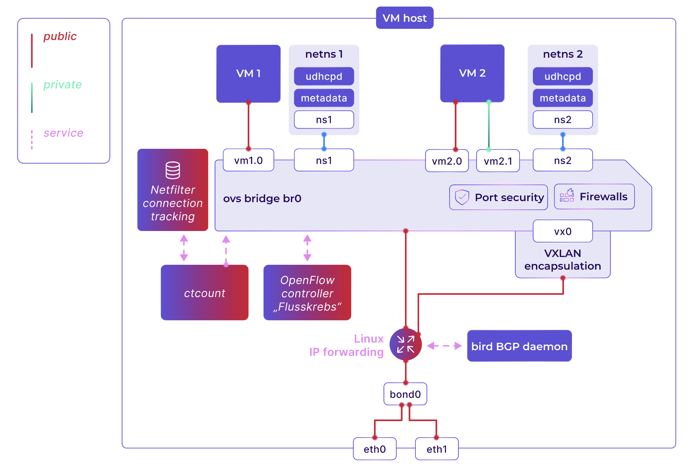

# Concepts and glossary

This page explains the building blocks that the rest of the notes rely on. If a term in the [README](../README.md) is unfamiliar, it is probably here.

- [Host, VM and the "network stack"](#host-vm-and-the-network-stack)
- [Inside an OVS host](#inside-an-ovs-host)
- [Linux bridge](#linux-bridge)
- [Open vSwitch and OpenFlow](#open-vswitch-and-openflow)
- [VXLAN](#vxlan)
- [Connection tracking (conntrack)](#connection-tracking-conntrack)
- [Stateless vs stateful firewalls](#stateless-vs-stateful-firewalls)
- [eBPF](#ebpf)
- [Offloads: GRO, TSO and checksums](#offloads-gro-tso-and-checksums)
- [DHCP and the metadata server](#dhcp-and-the-metadata-server)
- [Link-local addresses](#link-local-addresses)
- [IP fragmentation](#ip-fragmentation)
- [BGP and LACP](#bgp-and-lacp)
- [Kubernetes Services](#kubernetes-services)

---

## Host, VM and the "network stack"

A **host** is a physical server in a Hetzner datacenter. It runs a hypervisor (KVM) and many **VMs**, which are the cloud servers you rent.

Each VM has virtual network cards. On the host side, each virtual card shows up as a network interface (often a `tap` device). Something on the host must decide what happens to every packet that comes out of or goes into that interface:

- Is this VM allowed to send from this source address?
- Does a Cloud Firewall allow this packet?
- Is the destination the internet, another VM on the same host, or a VM on a private network on another host?
- Is this a DHCP or metadata request that the host answers itself?

The software that makes those decisions is the **network stack**. Hetzner has replaced it several times, and hcnet is the latest version.

```
  VM (your server)           Host                         Datacenter network
 ┌──────────────┐   tap   ┌─────────────────────────┐   uplinks   ┌──────────┐
 │ eth0 ────────┼─────────┤  network stack          ├─────────────┤ switches │
 │ ens10 ───────┼─────────┤  (bridge / OVS / hcnet) │             └──────────┘
 └──────────────┘         └─────────────────────────┘
```

## Inside an OVS host

Hetzner's own diagram of a host on the standard (OVS) stack puts most of the terms on this page in one picture:



*Source: [The history of the Hetzner Cloud network stack](https://www.hetzner.com/blog/the-hetzner-cloud-network-stack-history-and-technical-overview/), Hetzner blog.*

The line colours show the kind of traffic: **red** is public, **green** is private, and **dashed pink** is a service talking to another component (control traffic, not packets for your VM).

From top to bottom:

- **VMs and their ports.** Every VM network card becomes a port on the bridge, named `vm<VM>.<card>`. VM 1 has only a public card (`vm1.0`). VM 2 also has a private one (`vm2.1`), which inside the VM is `ens10`.
- **One namespace per VM (`netns 1`, `netns 2`).** Each holds that VM's `udhcpd` and metadata service. A veth pair (`ns1` on both ends) connects it to the bridge, so DHCP and `169.254.169.254` requests never leave the host. See [DHCP and the metadata server](#dhcp-and-the-metadata-server).
- **`ovs bridge br0`.** The single [Open vSwitch](#open-vswitch-and-openflow) bridge every port plugs into. The two boxes inside it, **Port security** (anti-spoofing) and **Firewalls** (Cloud Firewalls, blocked SMTP), are OpenFlow rules, not separate programs.
- **OpenFlow controller "Flusskrebs".** Hetzner's controller. Its dashed arrow to the bridge is it installing those rules.
- **Netfilter connection tracking and `ctcount`.** Stateful Cloud Firewall rules hand packets to the kernel's [conntrack](#connection-tracking-conntrack). Its table is shared by the whole host, so `ctcount` watches it and enforces the 80,000-connections-per-server limit. The arrows show it talking to both conntrack and the bridge.
- **`vx0` and VXLAN encapsulation.** Private traffic to a VM on another host leaves the bridge through `vx0` and is wrapped in a UDP packet. The wrapped packet is then ordinary public traffic between hosts, which is why its line turns red. See [VXLAN](#vxlan).
- **Linux IP forwarding.** The bridge's public side and the VXLAN tunnel both go to the host's kernel routing, not straight to the uplinks. If OVS breaks, Linux still routes, so the host stays reachable.
- **bird BGP daemon.** Tells the datacenter routers which IPs (VMs, Floating IPs) live on this host. See [BGP and LACP](#bgp-and-lacp).
- **`bond0` over `eth0` and `eth1`.** The two physical uplinks bonded together. Newer hosts replace the bond with two separately routed BGP links. See [Bond interfaces and host uplinks](bonding.md).

On hcnet, eBPF takes over the top half of this picture. Firewalls and conntrack become per-server eBPF programs instead of OVS flows plus netfilter, and DHCP and metadata are built in instead of running in a namespace per VM. Hetzner hasn't published a matching diagram for the routing and uplink layers, so compare with the [hcnet host diagram](../README.md#the-new-stack-hcnet) for what is known.

## Linux bridge

A Linux bridge is a software switch built into the kernel. It learns MAC addresses and forwards Ethernet frames between the interfaces plugged into it, like a cheap physical switch.

It is simple and fast, but it has little support for per-port policy. Rules like "VM 7 may only send from 203.0.113.7" have to be bolted on with `ebtables` or `iptables`. That is what Hetzner used in 2011 and 2015.

## Open vSwitch and OpenFlow

**Open vSwitch (OVS)** is a programmable software switch. Instead of only learning MAC addresses, it processes packets through **flow tables**. Each table holds rules of the form *match → actions*, and a controller installs those rules over the **OpenFlow** protocol.

Hetzner's controller is called **Flusskrebs**. Its rules for one VM port look roughly like this (illustrative pseudocode, not Hetzner's real rules):

```text
table=0  in_port=vm7, dl_src=96:00:00:aa:bb:cc          → goto table 3
table=0  in_port=vm7                                    → drop        # wrong MAC
table=3  in_port=vm7, ip, nw_src=203.0.113.7            → goto firewall
table=3  in_port=vm7, arp, arp_spa=203.0.113.7          → goto firewall
table=3  in_port=vm7                                    → drop        # spoofed IP
firewall in_port=vm7, tcp, tp_dst=25                    → drop        # SMTP blocked by default
firewall ...                                            → ct(commit), output to uplink
```

Table 0 checks the MAC address, and table 3 checks that the IP or ARP sender really belongs to the VM. The `ct(...)` action hands the packet to the kernel's connection tracker. That is how stateful Cloud Firewalls work on the standard stack.

**Why OVS hit its limits:** one OVS instance per host holds the flows for every VM on that host. That is many thousands of rules, all updated by an external controller. Hetzner names scalability, resiliency and flexibility as the problems once they passed a million servers.

## VXLAN

**VXLAN** (Virtual eXtensible LAN) is a way to carry Ethernet frames across an IP network. The sending host wraps the VM's frame inside a UDP packet (port 4789 by default) and adds a 24-bit **VNI** (VXLAN Network Identifier) that says which virtual network the frame belongs to.

```
┌───────────────── what the datacenter network sees ─────────────────┐
│ Outer Ethernet │ Outer IP (host A → host B) │ UDP 4789 │ VXLAN VNI │ ┌── what the VM sent ──┐
│                │                            │          │  = 4711   │ │ Eth │ IP 10.0.0.2→.3 │
└────────────────────────────────────────────────────────────────────┘ └──────────────────────┘
```

Each Hetzner private network gets its own VNI, so two customers can both use `10.0.0.0/16` without seeing each other. The receiving host strips the outer headers, looks at the VNI, and only delivers the frame to a VM that is a member of that network.

Because the outer headers take about 50 bytes, private networks have a smaller MTU than the public interface. Hetzner private networks use an MTU of 1450.

## Connection tracking (conntrack)

**Connection tracking** is a table of the flows currently passing through a firewall. An entry records the protocol, source and destination addresses and ports, and the state (for example `NEW`, `ESTABLISHED`).

```text
proto  src                 dst                 state         timeout
tcp    198.51.100.20:51544 203.0.113.7:443     ESTABLISHED   432000s
udp    203.0.113.7:41820   1.1.1.1:53          (reply seen)  30s
icmp   203.0.113.7         8.8.8.8 id=7        (reply seen)  30s
```

Things to know:

- **UDP and ICMP get entries too**, even though they have no real "connection". The tracker pairs a packet with its reply by addresses, ports or ICMP ID.
- **Entries time out.** An idle established TCP connection can stay in the table for a long time. Closed or half-open connections linger for seconds to minutes. A busy server can hold far more entries than it has active users.
- **The table has a size limit.** On Hetzner's standard stack that limit is 80,000 entries per server, enforced by a Hetzner tool called `ctcount`. On hcnet it is 120,000 for IPv4 plus 120,000 for IPv6.

**Important:** the Hetzner Cloud Firewall table lives **on the host**. Your VM cannot see it. If you run `iptables`, `ufw` or `nftables` inside the VM, the VM has its *own*, separate conntrack table (`/proc/sys/net/netfilter/nf_conntrack_count`). That table has nothing to do with the Hetzner limit.

## Stateless vs stateful firewalls

A **stateless** firewall looks at each packet on its own. To let your server make outgoing HTTPS calls, you would have to allow *all* inbound TCP traffic from port 443 back to your ephemeral ports. That is broad and easy to abuse.

A **stateful** firewall uses connection tracking. When your server opens a connection, the firewall records it. Replies that match a recorded connection are let in automatically, and anything else must match an inbound rule.

Hetzner Cloud Firewalls are stateful. They only filter traffic on the **public** interface, and private-network traffic passes unfiltered. This is why the connection table matters: if the firewall can't track a connection, it can't recognise the replies.

## eBPF

**eBPF** lets you load small programs into the Linux kernel and run them when something happens, such as a packet arriving on an interface. Three properties make it a good fit for a network stack:

1. **Verifier.** Before a program is loaded, the kernel proves that it terminates, never reads out-of-bounds memory and only calls allowed helpers. A buggy program is rejected instead of crashing the host.
2. **JIT compilation.** Verified programs are compiled to native machine code, so they run close to the speed of built-in kernel code.
3. **Maps.** Programs store state in kernel-managed key-value tables called maps. A per-server connection table is a natural fit for a map.

Common network hook points:

| Hook | Where it runs | Typical use |
|---|---|---|
| XDP | In the driver, before the kernel allocates its packet structure | Very fast drop/redirect, DDoS filtering |
| tc (traffic control) | On ingress/egress of an interface, after XDP | Filtering, rewriting, redirecting between interfaces |
| socket / cgroup hooks | Near applications | Per-process policy |

Hetzner hasn't published which hooks hcnet uses. The docs only say each firewall is "attached in front of the server's virtual NIC".

A toy firewall in eBPF looks like this (illustrative only, not Hetzner's code). It allows inbound TCP 443 and drops other TCP:

```c
SEC("tc")
int fw_in(struct __sk_buff *skb) {
    void *data = (void *)(long)skb->data, *end = (void *)(long)skb->data_end;
    struct ethhdr *eth = data;
    struct iphdr  *ip  = (void *)(eth + 1);
    if ((void *)(ip + 1) > end)          return TC_ACT_OK;    // verifier insists on bounds checks
    if (ip->protocol != IPPROTO_TCP)     return TC_ACT_OK;
    struct tcphdr *tcp = (void *)ip + ip->ihl * 4;
    if ((void *)(tcp + 1) > end)         return TC_ACT_SHOT;
    if (tcp->dest == bpf_htons(443))     return TC_ACT_OK;    // rule: allow tcp/443
    return TC_ACT_SHOT;                                       // default: drop
}
```

hcnet compiles each Cloud Firewall into a program like this, with the server's real rules and a connection-tracking map. Changing a firewall means compiling and swapping in a new program for that one server, without touching shared switch state.

For how the verifier, JIT, maps and hooks work, with a toy firewall you can run in Docker, see [eBPF in depth](ebpf.md).

## Offloads: GRO, TSO and checksums

Network cards and drivers can do work on behalf of the kernel:

- **TSO/GSO (segmentation offload):** the sender hands one big buffer (up to 64 KB) to the network card, and the card or driver cuts it into MTU-sized packets.
- **GRO (generic receive offload):** the receiver merges consecutive packets of the same flow back into one big buffer before passing it up the stack. That means fewer packets to process.
- **Checksum offload:** the card calculates TCP/UDP checksums instead of the CPU.

On hcnet, incoming packets reach your VM **exactly as they arrived on the wire**, without being merged on the host. Your VM can still merge them with its own GRO. You may see higher packet counters for the same bandwidth. Outgoing checksum and segmentation offloads are supported.

This has a real cost. Cloudfleet measured 12–38 KB merged packets arriving at the VM on the standard stack, against 1,514-byte packets on hcnet. The VM's virtio NIC has a single receive queue, so one vCPU processes all of them. Under heavy multi-stream TCP, that vCPU saturates and throughput roughly halves. See [benchmarks](benchmarks.md#why-plain-tcp-throughput-drops).

**Softirq** is the kernel context where received packets are processed after the NIC interrupt. It shows as `%soft` in `mpstat` or `si` in `top`. One vCPU at ~100% `%soft` while the others are idle is the sign of a single-queue receive bottleneck.

**RPS** (Receive Packet Steering) is a kernel feature that lets the vCPU handling the interrupt pass packets to other vCPUs for processing. It's the software workaround for a NIC with only one queue.

## DHCP and the metadata server

When a cloud server boots, it uses **DHCP** to get its IP address, default gateway and routes. On Hetzner, the DHCP server runs on the host, not somewhere in the datacenter.

The **metadata server** is an HTTP service at the well-known address `169.254.169.254`. Tools inside the VM query it to learn about the server:

```console
$ curl -s http://169.254.169.254/hetzner/v1/metadata/hostname
web-1
$ curl -s http://169.254.169.254/hetzner/v1/metadata/instance-id
51234567
$ curl -s http://169.254.169.254/hetzner/v1/metadata/public-ipv4
203.0.113.7
$ curl -s http://169.254.169.254/hetzner/v1/metadata/private-networks
- ip: 10.0.0.2
  alias_ips: []
  interface_num: 1
  mac_address: 86:00:00:12:34:56
  network_id: 1234567
  network_name: backend
  network: 10.0.0.0/16
  subnet: 10.0.0.0/24
  gateway: 10.0.0.1
```

`cloud-init` uses it on first boot to set the hostname, SSH keys and user data. The Hetzner CSI driver and cloud controller manager (Kubernetes) use it too. If the metadata server is unreachable, these tools fail in confusing ways.

The two stacks serve it differently:

- **OVS:** a small proxy in a per-VM network namespace on the host answers, over IPv4 only. `fe80::a9fe:a9fe` gets no reply. There is no dedicated route: requests follow the default route, if the server has one.
- **hcnet:** hcnet answers over IPv4 and over IPv6 at `fe80::a9fe:a9fe` (see [Link-local addresses](#link-local-addresses)), on every public and private interface. DHCP gives every interface an explicit route to `169.254.169.254`.

Because only hcnet answers on IPv6, a reply from `fe80::a9fe:a9fe` tells you the server is on hcnet.

Check which interface the server uses to reach the metadata server:

```console
$ ip route get 169.254.169.254
169.254.169.254 via 172.31.1.1 dev eth0 src 203.0.113.7
```

If an hcnet server doesn't show the per-interface routes:

- **The DHCP lease hasn't renewed since the switch.** The routes arrive with DHCP, and Hetzner can't force a renewal. Renew the lease or reboot (see the [switching guide](switching-guide.md#3-refresh-dhcp)).
- **The DHCP client doesn't display them all.** Some clients receive the routes but don't list every one in `ip route`. If `ip route get` picks a sensible interface and `curl` answers, nothing is wrong.

## Link-local addresses

`169.254.0.0/16` (IPv4) and `fe80::/10` (IPv6) are **link-local** ranges. They are only valid on the directly attached network segment and are never routed. That is why they are used for host services like metadata: the request can't accidentally leave the host.

`fe80::a9fe:a9fe` is the IPv6 twin of `169.254.169.254`: `a9fe` is hex for `169.254`.

Because every interface has its own `fe80::` network, you must say which interface to use. This is called a *zone ID*:

```console
$ curl -s 'http://[fe80::a9fe:a9fe%25eth0]/hetzner/v1/metadata/hostname'
web-1
```

`%25` is the URL-encoded `%` in `fe80::a9fe:a9fe%eth0`.

## IP fragmentation

If an IPv4 packet is larger than a link's MTU, it can be split into **fragments**. Only the **first fragment** carries the TCP or UDP header with the port numbers. Later fragments only carry the IP header and a slice of payload.

```
original UDP packet (3,000 bytes)
├── fragment 1: IP hdr │ UDP hdr (src 53 → dst 41820) │ payload 0–1471
├── fragment 2: IP hdr │                               │ payload 1472–2951
└── fragment 3: IP hdr │                               │ payload 2952–2991
```

A firewall rule like "allow UDP from port 53" can only be checked against fragment 1. hcnet remembers the decision for fragment 1 and applies it to the rest. If fragment 2 arrives *before* fragment 1, hcnet doesn't know the ports yet. That fragment can then only match rules that don't depend on ports, such as "allow all from 10.0.0.0/16".

IPv6 has no fragment tracking on hcnet. In practice, fragments are uncommon on modern networks because path MTU discovery avoids them. Watch for large UDP payloads, such as big DNS responses or some VPN setups.

## BGP and LACP

These describe how a **host** connects to the datacenter, not your VM:

- **LACP** bundles two physical links into one logical link (a *bond*). Both links must go to the same switch, or to a pair of switches acting as one.
- **BGP** is the internet's routing protocol. When each uplink speaks BGP to an *independent* switch, either switch can fail or be upgraded without the other knowing. Hetzner is moving hosts from LACP bonds to BGP-routed uplinks.

BGP also makes IP mobility easy: when a VM or a Floating IP moves to another host, the new host announces the route.

For bonding modes, hashing, MLAG and a hands-on example, see [Bond interfaces and host uplinks](bonding.md).

## Kubernetes Services

A **Service** groups a set of Pod endpoints into one resource and gives clients a way to reach them. Usually that is a stable **cluster IP** that clients inside the cluster use. A request sent to that IP goes to one of the Service's Pods, so clients don't need to track Pods as they come and go. On most clusters, `kube-proxy` or the CNI handles this inside the node's kernel, using the node's own conntrack table (see [Connection tracking in practice](conntrack-in-practice.md)).

There are five types of Services:

| Type | How clients reach it |
|---|---|
| **ClusterIP** (default) | A virtual IP that only works inside the cluster. |
| **NodePort** | A ClusterIP, plus the same port opened on every node's IP. Traffic that arrives on a node without a matching Pod is forwarded to another node. |
| **LoadBalancer** | A NodePort, plus an external load balancer in front of it. On Hetzner, the cloud controller manager creates a Hetzner Load Balancer, which already runs on hcnet. |
| **ExternalName** | No proxying at all: cluster DNS returns a CNAME to an outside hostname. |
| **Headless** | A ClusterIP Service with `clusterIP: None`. There is no virtual IP: DNS returns the Pod IPs directly, which StatefulSets and client-side load balancing rely on. |

### `type: LoadBalancer`

On cloud providers that support external load balancers, setting `type: LoadBalancer` makes the provider create one for the Service. That load balancer routes traffic to the Service in the region where the cluster runs.

The load balancer is created **asynchronously**. Once it exists, the provider publishes its address in the Service's `.status.loadBalancer` field:

```yaml
apiVersion: v1
kind: Service
metadata:
  name: my-service
spec:
  selector:
    app.kubernetes.io/name: MyApp
  ports:
    - protocol: TCP
      port: 80
      targetPort: 9376
  clusterIP: 10.0.171.239
  type: LoadBalancer
status:
  loadBalancer:
    ingress:
    - ip: 192.0.2.127
```

You write `spec`. Kubernetes assigns `clusterIP` if you leave it out, and the provider fills in `status` once the load balancer is ready. Until then, `kubectl get service my-service` shows `EXTERNAL-IP` as `<pending>`.

On Hetzner, the **hcloud cloud controller manager** does the provisioning. It creates a Hetzner Load Balancer that sends traffic to the Service's NodePort on each node. Hetzner Load Balancers already run on hcnet, but the nodes behind them may still be on OVS, and that is where the Cloud Firewall connection limit applies (see [Connection tracking in practice](conntrack-in-practice.md)).
