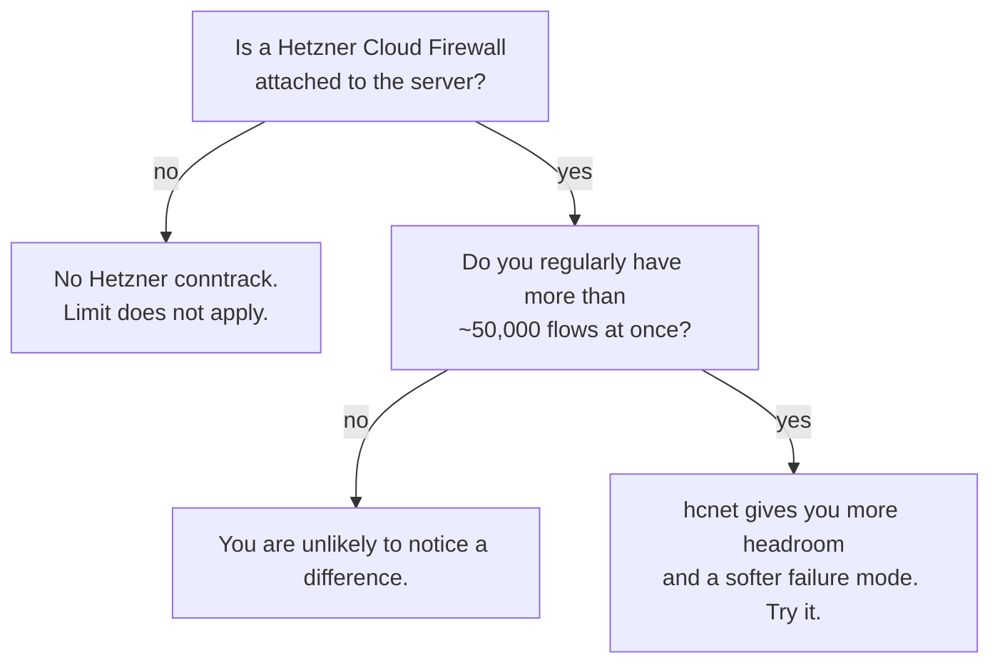

# Connection tracking in practice

The headline change in hcnet is the connection-tracking limit. This page covers how to tell whether you are near it, and how to plan around it.

- [Does the limit apply to me?](#does-the-limit-apply-to-me)
- [What counts as a connection](#what-counts-as-a-connection)
- [Estimating your usage from inside the VM](#estimating-your-usage-from-inside-the-vm)
- [Worked examples](#worked-examples)
- [Measured limits](#measured-limits)
- [Why the two stacks behave differently](#why-the-two-stacks-behave-differently)
- [Symptoms of hitting the limit](#symptoms-of-hitting-the-limit)
- [Ways to stay under the limit](#ways-to-stay-under-the-limit)
- [Firewall examples with the hcloud CLI](#firewall-examples-with-the-hcloud-cli)

---

## Does the limit apply to me?



Firewalls you run *inside* the VM (`ufw`, `iptables`, `nftables`, `firewalld`) use the VM's own kernel conntrack. That is a separate table with its own limit (`net.netfilter.nf_conntrack_max`). Switching to hcnet does not change it.

## What counts as a connection

Every flow the Hetzner firewall tracks, in either direction:

| Traffic | Tracked? | Note |
|---|---|---|
| Inbound TCP to your service | Yes | One entry per client connection |
| Outbound TCP (API calls, DB, package downloads) | Yes | Replies are only allowed because of this entry |
| UDP (DNS, QUIC/HTTP3, WireGuard, game servers) | Yes | Pairs a request with its reply; expires after an idle timeout |
| ICMP (ping, traceroute) | Yes | Short-lived |
| Recently closed TCP connections | Usually, briefly | Entries linger for a short while after close |
| Traffic on a server without a Cloud Firewall | No | Nothing is tracked |
| Private-network traffic | No | Cloud Firewalls only filter the public interface |

Hetzner doesn't publish the exact timeouts for either stack. As a rule of thumb, count **open connections plus a margin for recently closed ones**.

## Estimating your usage from inside the VM

You can't read the Hetzner table from inside the VM, but the kernel's socket counts are a good proxy.

**Summary of all sockets:**

```console
$ ss -s
Total: 41234
TCP:   40021 (estab 38512, closed 1210, orphaned 4, timewait 1198)

Transport Total     IP        IPv6
RAW       1         0         1
UDP       12        8         4
TCP       38811     30102     8709
```

Look at `estab` and `timewait`. On the standard stack, IPv4 and IPv6 share the 80,000 limit. On hcnet, compare each column against 120,000 separately.

`ss` counts sockets on every interface. Connections over private networks don't count toward the Hetzner limit, so subtract them (see the next examples).

**Established TCP connections, split by IP version:**

```console
$ ss -Htn4 state established | wc -l
30102
$ ss -Htn6 state established | wc -l
8409
```

**Top remote peers**, useful to spot one client or one backend holding thousands of connections:

```console
$ ss -Htn state established | awk '{print $4}' | sed 's/:[0-9]*$//' | sort | uniq -c | sort -rn | head
  12034 10.0.0.3
   2210 198.51.100.20
    ...
```

Here the 12,034 connections to `10.0.0.3` go over the private network, so they **don't** count. Only the public peers do.

**Public-interface connections only:**

```console
$ ss -Htn state established | awk '{print $4}' | grep -vE '^(10\.|\[?fd)' | wc -l
```

Adjust the pattern to your private ranges.

**Watch the trend over time** with a cron job or your monitoring agent. For example, node_exporter exposes `node_sockstat_TCP_inuse` and `node_netstat_Tcp_CurrEstab`. Alert at about 70% of the limit.

## Worked examples

**Small web app.** nginx in front of an app, 200 concurrent visitors, keep-alive on.
About 200 inbound, plus about 50 to the database, plus a few outbound. That is far below either limit, so hcnet changes nothing for you.

**WebSocket chat server.** 70,000 connected clients, 60% over IPv4 and 40% over IPv6.

| | Standard | hcnet |
|---|---|---|
| IPv4 | 42,000 | 42,000 / 120,000 |
| IPv6 | 28,000 | 28,000 / 120,000 |
| Against limit | **70,000 / 80,000 (88%)** | 35% and 23% |

On the standard stack, a traffic spike tips this over. On hcnet it has plenty of room.

**Self-hosted NAT gateway.** 40 private servers send their internet traffic through one gateway with a Cloud Firewall. Every outbound flow from every server is a tracked flow on the gateway. A few servers running crawlers or `apt update` in parallel can easily reach tens of thousands of flows. A good candidate for hcnet.

**DNS resolver.** 3,000 queries per second over UDP. If each entry lives for about 30 seconds, that is about 90,000 entries even though each query takes milliseconds. Short-lived UDP fills tables faster than people expect.

**Kubernetes node.** This is where 80,000 runs out fastest, because the budget is **per server, not per pod**. Every pod on the node shares the one table, and so does everything the node itself does. The numbers below are illustrative, but each line is a common pattern:

| Source on one node | How it adds up | Entries |
|---|---|---|
| Ingress controller, client side | 400 new connections/s × ~65 s (a few seconds open, ~60 s lingering after close) | 26,000 |
| Ingress hop through a NodePort | With `externalTrafficPolicy: Cluster`, the Load Balancer may hit this node while the pod runs on another. The node forwards the connection, so one client connection is **two** flows here: in from the Load Balancer, out to the other node. | 26,000 |
| Database proxy (PgBouncer, ProxySQL) | Apps that connect per request: 200 connections/s × ~65 s | 13,000 |
| DNS leaving the node | 300 queries/s to upstream resolvers × ~30 s. `ndots:5` and A + AAAA lookups multiply each name several times. | 9,000 |
| Service mesh sidecars | 30 pods × 50 upstream endpoints on other nodes × 4 pooled connections | 6,000 |
| Image pulls, external APIs, telemetry | | 5,000 |
| **Total** | | **~85,000** |

That is at the standard stack's wall, on a node whose CPU and bandwidth look quiet. For how the Load Balancer → node path works and how to keep it out of the budget, see [Kubernetes LoadBalancer Services](kubernetes.md). A few things decide whether your node looks like this:

- **Traffic over a private network doesn't count.** Cloud Firewalls only filter public interfaces. If nodes talk to each other over a Hetzner private network, the node-to-node lines above drop out. Clusters that use public IPs between nodes (no private network, multi-location, or hybrid) pay for every one.
- **Overlay encapsulation decides how flows look on the host.** VXLAN and Geneve set the outer UDP source port from a hash of the inner flow, so each pod-to-pod connection shows up as its own outer flow. WireGuard (Cilium or Calico encryption, Tailscale) wraps everything between two nodes in **one** UDP flow per peer, which collapses those entries.
- **Lingering entries dominate.** Short-lived connections count for about a minute after they close (see [why recovery takes a minute](#why-recovery-takes-a-minute-on-the-standard-stack)). Keep-alive and connection pooling cut the numbers above by orders of magnitude.
- **The node has a second table of its own.** `kube-proxy` and most CNIs use the node's kernel conntrack, which has its own limit (`nf_conntrack_max`; `kube-proxy` sets it to 32,768 per CPU core, at least 131,072). That table is usually larger than the Cloud Firewall's, so the host-side limit is hit first.

## Measured limits

Cloudfleet's [benchmark](benchmarks.md#connection-tracking-measured) filled the table on purpose:

| | Standard | hcnet |
|---|---|---|
| IPv4 only | 83,998 | 119,994 |
| IPv4 + IPv6 together | ~88,000 total | 119,992 + 120,000 |
| Recovery after the load stopped | 44–64 s | 0–3 s |
| SSH during the overload | Unreachable | Reachable |
| Allow-all firewall, 160,000 attempted | Stopped at ~86,000 | All 160,000 accepted |

The standard stack lets a few thousand more through than the documented 80,000, but plan for 80,000.

**Where "1.4×" and "up to 2.7×" come from.** On the standard stack, IPv4 and IPv6 share one pool. On hcnet, each family has its own 120,000, and whichever family fills first is the one that runs out. So the total you can carry on hcnet depends on how your traffic is split:

| IPv4 share of your connections | hcnet total before one family is full | vs. ~84,000–88,000 on standard |
|---|---|---|
| 100% (IPv4 only) | 120,000 | **~1.4×** (119,994 ÷ 83,998) |
| 70% | 171,000 (IPv4 full; IPv6 at 51,000) | ~2× |
| 50% | 240,000 (both full) | **~2.7×** (239,992 ÷ 88,000) |

The rule: **hcnet ceiling = 120,000 ÷ the share of the bigger family.** 2.7× is the best case and needs an even split. Most public-facing services see far more IPv4 than IPv6, so expect something between 1.4× and 2×, unless you route internal or node-to-node traffic over IPv6 on purpose.

## Why the two stacks behave differently

Hetzner hasn't published the internals of either stack. The explanations below follow from how Linux conntrack and eBPF maps work, and they fit the measurements. Treat them as informed inference, not documentation.

### It isn't file descriptors

A conntrack entry is a small record in **kernel memory on the host**: the flow's addresses, ports, protocol, state and an expiry time. It isn't a file descriptor, and it doesn't belong to any process.

File descriptors live **inside your VM**. Each open socket uses one, and `ulimit -n` caps how many a process may hold. The two counts are related but not the same:

| | File descriptor (in the VM) | Conntrack entry (on the host) |
|---|---|---|
| Created when | Your program opens a socket | The host sees the first packet of a new flow |
| Freed when | Your program calls `close()` | The entry's timeout expires and it is cleaned up |
| Covers | Only sockets on this VM | Every flow through the Cloud Firewall, including ones the VM never accepted |
| Limit | `ulimit -n`, `fs.file-max` | 80,000 (standard) or 120,000 per family (hcnet) |

The key difference is the last step. Closing a socket frees its file descriptor immediately. The conntrack entry stays behind, because the tracker still has to recognise the late FIN, ACK or retransmission that belongs to that flow.

### One shared pool vs. two separate ones

**Standard stack.** OVS hands packets to the Linux kernel's conntrack with `ct(commit)`. Linux keeps **one table for all protocols**. IPv4 and IPv6 entries sit side by side, and each VM's entries are most likely kept apart with a conntrack *zone*. `ctcount` caps the number of entries in that zone, without looking at the address family. That is why IPv4 and IPv6 hit the wall together.

The overshoot to 84,000–88,000 suggests the count is enforced **lazily**, for example by checking periodically or by counting stale entries only when it next looks at them. Connections opened between two checks get in. The faster you open connections, the bigger the overshoot, which fits the higher figure in the mixed IPv4 + IPv6 test.

**hcnet.** An eBPF program stores its state in **maps**, and every map is created with a fixed `max_entries`. An IPv4 key (two 4-byte addresses) and an IPv6 key (two 16-byte addresses) have different sizes, so the natural design is one map per family. When a map is full, inserting fails at once, with no lag. That is why each family stops at exactly 120,000, independently. The few missing entries (119,992, 119,994) are flows that already existed, such as the SSH session and DHCP.

### Why SSH dies on one stack and not the other

A new SSH login is a new flow, so it needs a new entry.

- **Standard stack:** with the zone full, `ct(commit)` fails and the SYN is dropped silently. Nothing new gets in or out, SSH included. Only flows that already had an entry keep working.
- **hcnet:** when the insert fails, the program skips tracking and checks the packet against your rules only. An inbound SYN to port 22 matches your "allow TCP 22" rule and passes. The server's reply goes outbound, which the default policy allows. SSH works without an entry.

The same fallback is why outbound connections still fail on hcnet. The reply to *your* request arrives at a random high port. No rule allows that, and there is no entry to say it's a reply, so it's dropped.

### Why an allow-all firewall still fails on the standard stack

The allow-all test shows the difference most clearly. The two stacks put tracking and rule checks in a different order:

```text
STANDARD STACK                                  hcnet

  new connection                                  new connection
        │                                               │
┌───────▼────────┐                              ┌───────▼────────┐
│ add a conntrack│                              │ already        │── yes ──▶ pass
│ entry          │                              │ tracked?       │
└───────┬────────┘                              └───────┬────────┘
        ├── table full ──▶ DROP                         │ no
        │   (rules never asked)                 ┌───────▼────────┐
┌───────▼────────┐                              │ rules allow it?│── no ──▶ drop
│ rules allow it?│── no ──▶ drop                └───────┬────────┘
└───────┬────────┘                                      │ yes
        │ yes                                   ┌───────▼────────┐
        ▼                                       │ add an entry   │── table full ──▶ pass anyway,
       pass                                     └───────┬────────┘                  untracked
                                                        │ ok
                                                        ▼
                                                       pass
```

**Standard stack.** Every flow through a Cloud Firewall gets a conntrack entry, even when the rules would allow it anyway. The rules never get a say once the zone is full. The flow is dropped before anyone asks whether it's allowed. An allow-all firewall therefore stops at the same ~86,000 as a strict one.

**hcnet.** A tracked entry only matters for one thing: letting replies through that no rule allows. With an allow-all firewall, every packet in both directions matches a rule, so nothing needs an entry. After the first ~120,000 flows filled the table, the remaining 40,000 were checked against the rules, matched "allow all" and passed. None failed.

The takeaway: on hcnet, **the more of your traffic an explicit rule covers, the less a full table hurts you.** On the standard stack, rules make no difference once the table is full.

### Why recovery takes a minute on the standard stack

On the standard stack, three delays stack up after you close your connections:

1. **Closed isn't gone.** A closed TCP flow moves to a closing state (`FIN_WAIT`, `TIME_WAIT`, `CLOSE`) and keeps its entry until that state times out. Linux defaults range from 10 s (`CLOSE`, after a reset) to 120 s (`TIME_WAIT`). Hetzner may have tuned them.
2. **Expired isn't removed.** Linux doesn't delete an entry the moment it expires. A background garbage collector sweeps the table in steps, and on current kernels it can wait **up to 60 seconds** between sweeps when the table looks idle. Until then, expired entries still count against the limit.
3. **The limit is checked lazily.** If `ctcount` re-checks the count only periodically, its view lags the real table.

Together these land in the 44–64 s range that was measured.

On hcnet, the eBPF program owns the map and its expiry. The measured 0–3 s suggests it deletes entries as soon as a flow ends (on FIN or RST), or sweeps the map every few seconds. The space is free for new flows almost immediately.

### What this means for you

- **Count flows, not sockets.** `ss -s` in the VM shows sockets; it doesn't show entries still waiting to expire on the host. Leave margin for recently closed flows (see [Estimating your usage](#estimating-your-usage-from-inside-the-vm)).
- **Raising `ulimit -n` doesn't help** with the Cloud Firewall limit, and lowering it doesn't protect you either. The host doesn't know about your file descriptors.
- **On the standard stack, a spike costs about a minute** even after it ends. Plan for that in health checks and alerting.

## Symptoms of hitting the limit

**Standard stack:**

- New connections, both inbound and outbound, time out (no RST, just silence).
- **That includes SSH**, so you may be locked out. Use the web console in the Hetzner Console to get in.
- CPU, memory and bandwidth look normal.
- It recovers by itself, but slowly: about a minute (44–64 s measured) after the load drops.

**hcnet:**

- New inbound connections that match an explicit rule keep working.
- Outbound connections and other traffic that relies on tracked replies time out.
- Only the IP version that is full is affected.
- It recovers within a few seconds (0–3 s measured) once the load drops.

A quick test while it's happening:

```console
$ curl -sS -m 5 -o /dev/null -w '%{http_code}\n' https://example.com
curl: (28) Connection timed out after 5001 milliseconds   # outbound broken
$ ss -s | head -2                                          # how many flows right now?
```

## Ways to stay under the limit

- **Use connection pooling** to your database and internal APIs instead of opening a connection per request.
- **Shorten idle timeouts** for clients that don't need long-lived connections (`keepalive_timeout` in nginx, for example).
- **Spread load** across several servers behind a Hetzner Load Balancer. Each server has its own budget, and Load Balancers already run on hcnet.
- **Use IPv6.** On hcnet, IPv6 has its own 120,000 budget.
- **Move internal traffic to private networks.** Database, cache and service-to-service traffic over a private network isn't filtered by Cloud Firewalls, so it doesn't use the connection budget.
- **Add explicit rules for critical replies** (on hcnet). Replies that match a rule still get through when the table is full. See the next section.

## Firewall examples with the hcloud CLI

These examples use the official [`hcloud` CLI](https://github.com/hetznercloud/cli).

**A typical web server firewall:**

```bash
hcloud firewall create --name web

# SSH only from the office
hcloud firewall add-rule web --direction in --protocol tcp --port 22 \
  --source-ips 198.51.100.0/24 --description "ssh from office"

# HTTPS from anywhere, IPv4 and IPv6
hcloud firewall add-rule web --direction in --protocol tcp --port 443 \
  --source-ips 0.0.0.0/0 --source-ips ::/0 --description "https"

# Allow ping
hcloud firewall add-rule web --direction in --protocol icmp \
  --source-ips 0.0.0.0/0 --source-ips ::/0

hcloud firewall apply-to-resource web --type server --server web-1
```

**Applying to many servers by label:**

```bash
hcloud firewall apply-to-resource web --type label_selector --label-selector role=web
```

**Making critical replies robust when the table is full (hcnet only):** if `web-1` depends on an external API at `192.0.2.50`, allow its replies explicitly so they don't depend on a tracked entry:

```bash
hcloud firewall add-rule web --direction in --protocol tcp --port 1024-65535 \
  --source-ips 192.0.2.50/32 --description "API replies, robust without conntrack"
```

This opens your ephemeral ports to that one peer, so only do it for peers you trust.

**Reviewing the rules and which servers they apply to:**

```bash
hcloud firewall describe web
```
