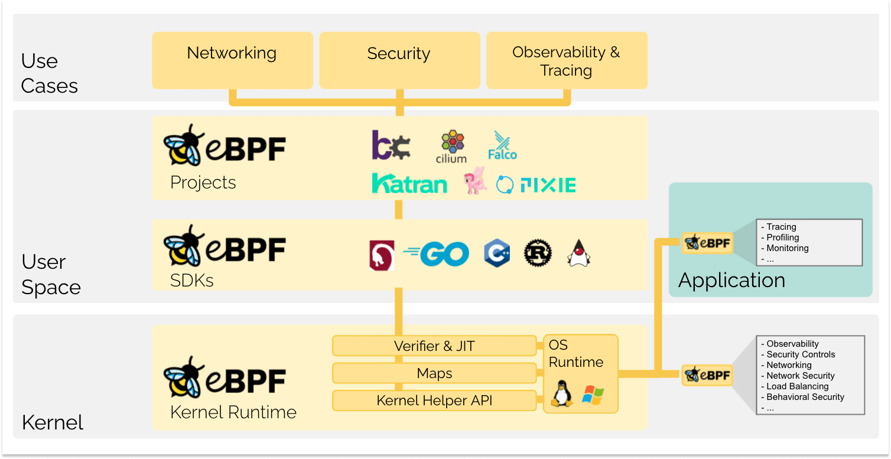
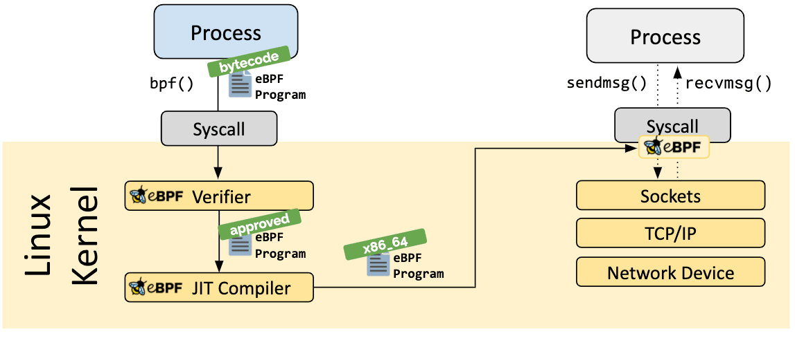
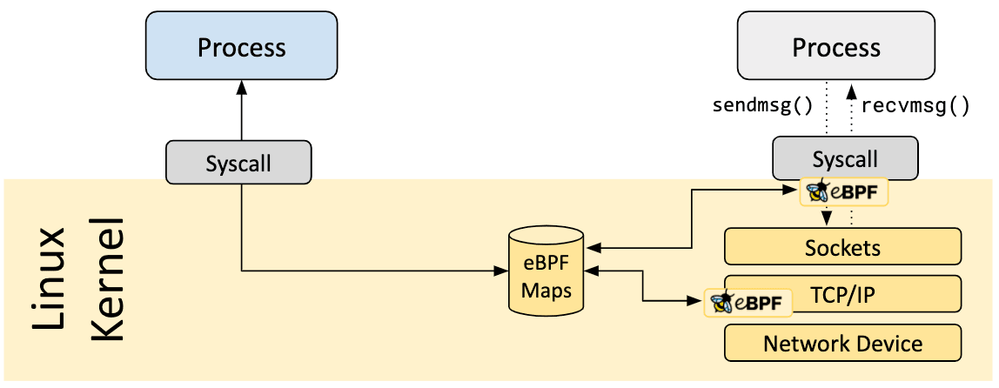
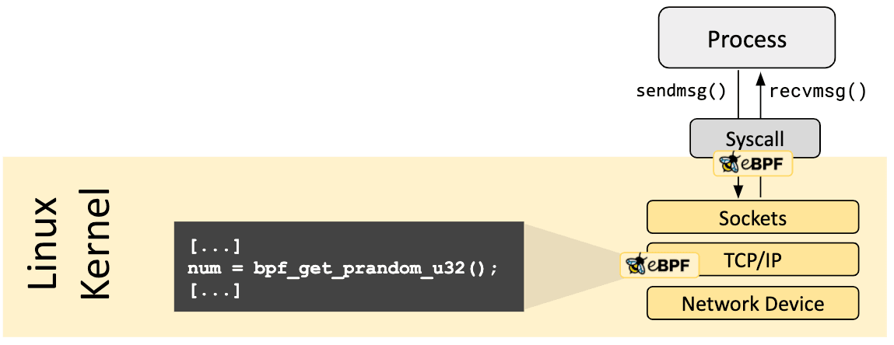
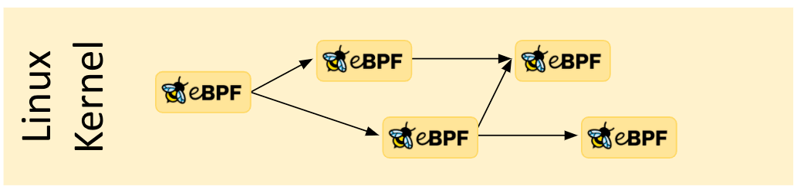
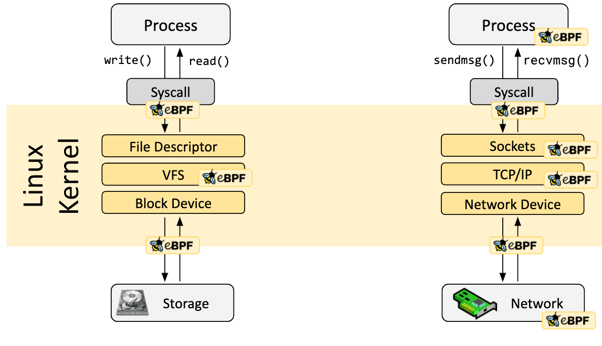

# eBPF: how hcnet's building block works

hcnet is built on **eBPF**. Each Cloud Firewall is compiled into its own small program that runs inside the host's Linux kernel, in front of your server's virtual network card. This page explains how such a program gets from C source to a running packet filter. It also covers what keeps it safe and where its state lives, and why a full connection table behaves the way it does on hcnet.

Everything here comes from the Linux source (a 6.19-rc8 tree), from a toy firewall run in a lab, and from the introduction at [ebpf.io](https://ebpf.io/what-is-ebpf/). Hetzner hasn't published hcnet's code. Where this page says how hcnet *probably* does something, that is inference from how eBPF works and from Hetzner's documented behaviour.

The diagrams marked *ebpf.io* are from [What is eBPF?](https://ebpf.io/what-is-ebpf/), licensed under [CC BY 4.0](https://creativecommons.org/licenses/by/4.0/).

- [What eBPF is, and why not a kernel module](#what-ebpf-is-and-why-not-a-kernel-module)
- [The big picture](#the-big-picture)
- [The virtual machine inside the kernel](#the-virtual-machine-inside-the-kernel)
- [The verifier: proof before loading](#the-verifier-proof-before-loading)
- [Rewriting and JIT compilation](#rewriting-and-jit-compilation)
- [Maps: where state lives](#maps-where-state-lives)
- [What happens when a map is full](#what-happens-when-a-map-is-full)
- [Helpers, function calls and tail calls](#helpers-function-calls-and-tail-calls)
- [Hook points: where programs run](#hook-points-where-programs-run)
- [Safety beyond the verifier](#safety-beyond-the-verifier)
- [A toy Cloud Firewall](#a-toy-cloud-firewall)
- [Changing rules without a gap](#changing-rules-without-a-gap)
- [Verified in a lab](#verified-in-a-lab)
- [What the toy leaves out](#what-the-toy-leaves-out)
- [Sources](#sources)

---

## What eBPF is, and why not a kernel module

eBPF lets you run small, sandboxed programs **inside the Linux kernel** without changing the kernel's source or loading a kernel module. The kernel checks each program before it runs and compiles it to native code, so it is both safe and fast.



*Diagram: ebpf.io, CC BY 4.0.*

The name is historical. BPF stood for *Berkeley Packet Filter*, the 1990s mechanism behind `tcpdump` filters, now called classic BPF (cBPF). eBPF ("extended") does far more than filter packets, so today the name doesn't stand for anything. The kernel source still says BPF, and the two terms are used interchangeably.

Before eBPF, putting new packet-handling logic into the kernel left two options:

| Option | Cost |
|---|---|
| **Change the kernel itself** | Convince the kernel community, then wait years for that kernel version to reach every host |
| **Write a kernel module** | Can break with every kernel release, and a single bug can crash the whole machine |

For a cloud host carrying dozens of customers' servers, neither fits. A crashed host takes every VM on it down, and a per-customer firewall can't wait for a kernel release. eBPF removes both problems: programs are loaded at runtime, the verifier refuses anything that could crash the kernel, and the program only uses stable interfaces (helpers and context structs), so it keeps working across kernel upgrades. ebpf.io compares it to what JavaScript did for browsers: new behaviour ships without shipping a new browser.

---

## The big picture



*Diagram: ebpf.io, CC BY 4.0.*

The same flow in more detail, including maps:

```text
  you write                 compiler              kernel                        runs on
┌───────────┐  clang    ┌──────────────┐  bpf()  ┌──────────┐   ┌─────────┐   ┌──────────────────┐
│ fw.bpf.c  │ ───────▶  │ fw.bpf.o     │ ──────▶ │ verifier │ ─▶│   JIT   │ ─▶│ hook: tc / XDP   │
│ (C)       │ -target   │ eBPF bytecode│ syscall │ proves   │   │ native  │   │ every packet on  │
└───────────┘   bpf     │ + map specs  │         │ it safe  │   │ arm64 / │   │ that interface   │
                        └──────────────┘         └──────────┘   │ x86 code│   └────────┬─────────┘
                                                      │         └─────────┘            │ lookups,
                                                      ✗ rejected: never loads          ▼ updates
                                                                               ┌──────────────────┐
                                    userspace (bpftool, a controller) ◀──────▶ │ maps (key/value) │
                                                                               └──────────────────┘
```

1. You write a small C function and compile it with `clang -target bpf`. The result is an ELF file with **eBPF bytecode** and a description of the **maps** it uses.
2. A loader (libbpf, `bpftool`, `tc`, or Hetzner's own tooling) creates the maps and passes the bytecode to the kernel with the `bpf()` system call.
3. The **verifier** walks every possible path through the program. If it can't prove the program is safe, the load fails and nothing runs.
4. The kernel **rewrites** a few instructions and **JIT-compiles** the program to native machine code.
5. The program is **attached** to a hook, such as an interface's traffic-control (tc) hook. From then on it runs for every packet passing that point and returns a verdict: pass, drop or redirect.
6. **Maps** hold state between packets. Both the program and userspace can read and write them.

### On hcnet: from the Console to your vNIC

The same pipeline, as it applies to a Cloud Firewall:

1. **Standalone compilation.** When you create or change a Cloud Firewall in the Console or API, Hetzner's control plane compiles that firewall's rules into its own eBPF program. Your rules aren't entries in a shared rule set; they are code.
2. **Verification and JIT on the host.** The program is loaded into the kernel of the host (hypervisor) your server runs on. The [verifier](#the-verifier-proof-before-loading) proves the bytecode can't crash or hang that kernel, and the [JIT](#rewriting-and-jit-compilation) turns it into native machine code.
3. **Attached in front of the vNIC.** The machine code is attached at the host-side interface of your server's virtual network card (see [Hook points](#hook-points-where-programs-run)). Each packet to or from your server is judged there, before it goes anywhere else on the host.

Compare the standard stack: a packet crosses the OVS bridge, matches OpenFlow flows, and is handed to the kernel's netfilter conntrack, whose table is shared by every VM on the host (see [Inside an OVS host](concepts.md#inside-an-ovs-host)). On hcnet, the check happens once, at your server's own interface, in a program built just for your firewall, with its own connection table.

---

## The virtual machine inside the kernel

### What "virtual CPU" means

A real CPU (x86 in most servers, arm64 in newer ones) runs **machine code**: a list of very simple instructions such as "load a number from memory", "compare two numbers", "jump if greater". Normally a compiler turns C straight into machine code for one specific chip.

eBPF adds a step in between. `clang -target bpf` produces machine code for a CPU that **doesn't exist as hardware**. It's an instruction set someone designed on paper, which is why it's called virtual. The kernel takes those instructions, checks them, and only then translates them into real instructions for the actual chip.

```text
 C source ──clang──▶ eBPF instructions ──verifier──▶ JIT ──▶ real arm64 / x86 instructions
                     (for the paper CPU)  (checks)   (translates)
```

Java bytecode and WebAssembly work the same way. Why not compile straight to x86 or arm64?

- **The kernel can check it.** The eBPF instruction set is small and strict, so the verifier can reason about every instruction. Proving anything about arbitrary x86 machine code is practically impossible.
- **One program runs everywhere.** The same `.o` file loads on an x86 host and an arm64 host. The kernel does the final translation for whatever chip it runs on.

### The parts of the paper CPU

| Part | What it is | In eBPF |
|---|---|---|
| **Registers** | The CPU's handful of scratch slots. All calculation happens in registers; memory is only for loading and storing. | 11 slots, `r0`–`r10`, each holding a 64-bit number or pointer |
| **Stack** | A small scratch area in memory for local variables that don't fit in registers | 512 bytes. That's deliberately tiny; a normal program's stack is megabytes. |
| **Instructions** | The operations the CPU understands | About 100: arithmetic, load and store, compare-and-jump, `call`, `exit`. Each is exactly 8 bytes. |
| **Helpers** | The only way to do anything beyond arithmetic | `call` can only reach a fixed, numbered list of kernel functions, such as `bpf_map_lookup_elem` or `bpf_ktime_get_ns`. No system calls, no libraries, no `malloc`. |

Some registers have fixed jobs:

| Register | Job |
|---|---|
| `r1` | On entry, holds a pointer to the **context**: for a packet filter, the packet's metadata (`struct __sk_buff`) |
| `r0` | On `exit`, holds the **return value**: for tc, the verdict (`0` = pass, `2` = drop) |
| `r1`–`r5` | Arguments when calling a helper |
| `r6`–`r9` | Survive helper calls; used to keep values around |
| `r10` | Points at the stack; read-only |

### A complete example

This program drops packets longer than 1,000 bytes and passes the rest:

```c
SEC("tc")
int tiny(struct __sk_buff *skb)
{
        if (skb->len > 1000)    /* big packet? */
                return 2;       /* TC_ACT_SHOT: drop */
        return 0;               /* TC_ACT_OK: pass */
}
```

`clang -O2 -target bpf` turns it into six eBPF instructions (`llvm-objdump -d tiny.o`):

```text
       raw 8 bytes                 meaning
  0:   61 11 00 00 00 00 00 00     r1 = *(u32 *)(r1 + 0)       load skb->len (offset 0) into r1
  1:   b7 00 00 00 01 00 00 00     r0 = 1                      assume "big"
  2:   25 01 01 00 e8 03 00 00     if r1 > 1000 goto +1        0x3e8 = 1000; if big, skip the next line
  3:   b7 00 00 00 00 00 00 00     r0 = 0                      not big
  4:   67 00 00 00 01 00 00 00     r0 <<= 1                    1 → 2 (drop), 0 → 0 (pass)
  5:   95 00 00 00 00 00 00 00     exit                        return r0
```

Read it like this:

- The program starts with `r1` pointing at the packet's metadata, as the table above says.
- **Instruction 0** reads the packet length from that structure into `r1`.
- **Instructions 1–4** compute the answer without a branch to `return`. The compiler noticed that "2 or 0" equals "(len > 1000) × 2", so it sets `r0` to 1 or 0 and doubles it by shifting left.
- **`exit`** hands `r0` back to the kernel as the verdict.

In each raw 8 bytes, the first byte is the operation: `61` load 32 bits, `b7` set to a constant, `25` jump if greater, `67` shift left, `95` exit. The second byte names the registers. The last four bytes hold a constant: `e8 03 00 00` is 1,000, stored least significant byte first.

After the verifier approves it, the JIT translates each of these into one or two instructions for the real chip. For comparison, here is the same logic compiled directly for arm64, with a stand-in for the packet structure (so the offset `#16` differs). It's the same shape, five real instructions:

```text
  ldr   w8, [x0, #16]     load len
  cmp   w8, #1000         compare with 1000
  cset  w8, hi            w8 = 1 if greater, else 0
  lsl   w0, w8, #1        × 2
  ret                     return
```

That's why JIT-compiled eBPF runs at close to the speed of code built into the kernel: after translation, it *is* ordinary machine code.

### The lab firewall at this level

The toy firewall in [`lab/ebpf/fw.bpf.c`](../lab/ebpf/fw.bpf.c) is the same idea, just longer: 308 instructions for the inbound direction. Here is a piece of it as the kernel holds it (`bpftool prog dump xlated`), with the C source shown in the `;` lines:

```text
; if ((void *)(eth + 1) > end)
  25: (bf) r1 = r4                     r4 = start of packet
  26: (07) r1 += 14                    + Ethernet header
  27: (2d) if r1 > r2 goto pc+278      r2 = end of packet → bail out
; if (eth->h_proto == bpf_htons(ETH_P_IP)) {
  28: (71) r5 = *(u8 *)(r4 +12)        safe now: the verifier knows 14 bytes exist
```

---

## The verifier: proof before loading

The verifier (`bpf_check()` in `kernel/bpf/verifier.c`) is the reason a bug in a firewall program can't crash the host. It simulates the program on every path, tracking what each register might hold: a number in some range, a pointer to the packet with a known safe length, a map value, or something that might be `NULL`.

It refuses to load a program unless it can prove these things:

| It proves | So you must write |
|---|---|
| Every packet read is inside the packet | An explicit `if (ptr + size > data_end)` check before each access |
| Every map lookup result is checked for `NULL` | `v = bpf_map_lookup_elem(...); if (!v) ...` |
| The program ends | Loops with a bound the verifier can see (or the `bpf_loop` helper) |
| Only allowed helpers are called, with correct argument types | Helpers permitted for this program type |
| Nothing reads uninitialised stack or leaks kernel pointers | Zero-initialised structs |

There's also a hard limit on effort. The verifier gives up after simulating **1,000,000 instructions** across all paths (`BPF_COMPLEXITY_LIMIT_INSNS` in `include/linux/bpf.h`). This is why eBPF programs stay small and simple, and why a firewall with thousands of rules is better expressed as a **map lookup** than as thousands of `if` statements.

Two deliberately broken programs from the lab ([`lab/ebpf/bad.bpf.c`](../lab/ebpf/bad.bpf.c)), and the kernel's answers:

```text
--- reads the IP protocol field without checking the packet length:
invalid access to packet, off=23 size=1, R1(id=0,off=23,r=0)
R1 offset is outside of the packet
libbpf: prog 'no_bounds_check': failed to load: -13

--- while (skb->len > 0) i++;
infinite loop detected at insn 4
libbpf: prog 'endless': failed to load: -22
```

`r=0` means the verifier has proven that 0 bytes of the packet are safe to read, and the program tried to read byte 23. Nothing ran, and the host never saw the bad code.

---

## Rewriting and JIT compilation

After verification, the kernel changes the program before it runs. The lab shows three rewrites:

**1. Context fields become real offsets.** Your program reads `skb->data` from `struct __sk_buff`, a stable interface that never changes between kernels. The kernel rewrites that into a load from the real, internal `struct sk_buff`:

```text
; void *data = (void *)(long)skb->data;
  24: (79) r4 = *(u64 *)(r7 +208)
```

**2. Array lookups are inlined.** The config lookup was `bpf_map_lookup_elem(&cfg, &zero)` in C. For an array map, the kernel replaced the helper call with direct pointer arithmetic, so no call is left:

```text
  12: (18) r1 = map[id:44]
  14: (07) r1 += 312                   start of the array's values
  15: (61) r0 = *(u32 *)(r2 +0)        index
  16: (35) if r0 >= 0x1 goto pc+3      bounds check → NULL
  17: (67) r0 <<= 3                    index × value size
  18: (0f) r0 += r1
```

**3. Hash lookups call the map's implementation directly.** For the connection table, the generic `bpf_map_lookup_elem` became `call __htab_map_lookup_elem`, skipping a level of indirection.

**Then it's compiled to machine code.** The JIT (`bpf_int_jit_compile()` in `arch/arm64/net/bpf_jit_comp.c` and `arch/x86/net/bpf_jit_comp.c`) translates each eBPF instruction into one or a few native instructions. eBPF registers map directly onto CPU registers. In the lab, the inbound program was 308 eBPF instructions (2,464 bytes) and became **1,648 bytes of arm64 code**:

```text
98: sched_cls  name to_vm  tag 43321af8c6ae7063  gpl
	xlated 2464B  jited 1648B  memlock 4096B  map_ids 44,43,42,45,41
```

The lab kernel is built with `CONFIG_BPF_JIT_ALWAYS_ON=y`, which removes the bytecode interpreter entirely: every program runs as native code.

Measured with `kernel.bpf_stats_enabled=1`, the toy firewall took about **160–250 ns per packet** in the lab. That includes a parse, a hash lookup and sometimes an insert. The lab ran in a Docker Desktop VM, and switching the statistics on adds overhead of its own, so treat that as an order of magnitude, not a benchmark.

---

## Maps: where state lives

A map is a kernel-managed table with a fixed key size, value size and maximum number of entries, all set when it's created. Programs reach maps through helpers. Userspace reaches them through the `bpf()` system call, for example with `bpftool map dump`.



*Diagram: ebpf.io, CC BY 4.0.*

The diagram shows why maps matter for a firewall: one map can be shared by several programs (for example the inbound and outbound programs of the same server, which must see the same connection table) and by a userspace agent that reads counters or cleans up entries.

| Map type | What it is | Firewall use |
|---|---|---|
| `HASH` | Hash table | Connection table, rule lookups |
| `LRU_HASH` | Hash table that evicts the least recently used entry when full | Caches where losing an old entry is acceptable |
| `ARRAY` | Fixed-size array indexed by number; lookups get inlined | Configuration |
| `PERCPU_ARRAY` / `PERCPU_HASH` | One copy per CPU, no locking needed | Counters and statistics |
| `LPM_TRIE` | Longest-prefix match | CIDR rules such as "allow from 10.0.0.0/16" |
| `PROG_ARRAY` | Table of other programs | Tail calls between programs |

Here's a connection-table entry from the lab, read by `bpftool` while one connection was open:

```text
"value": {
    "created_ns": 1600285560521,
    "last_seen_ns": 1600285620771,
    "packets": 3,
    "fin_seen": 0,
    "pad": 0
}
```

**Maps outlive programs.** A map stays alive as long as something references it: a program, an open file descriptor, or a pin in the BPF filesystem (`/sys/fs/bpf/...`). That makes it possible to replace a firewall program while keeping its connection table. See [Changing rules without a gap](#changing-rules-without-a-gap).

**Why one map per address family.** A map has one fixed key size. An IPv4 connection key needs two 4-byte addresses and an IPv6 key needs two 16-byte ones. Separate `ct4` and `ct6` maps are the natural design, and each one has its own `max_entries`. That matches hcnet's documented limit of 120,000 IPv4 plus 120,000 IPv6, with the two counting independently.

---

## What happens when a map is full

This is the core of hcnet's documented behaviour, so here is exactly what the kernel does. When a program calls `bpf_map_update_elem()` on a full `HASH` map, the insert fails. It doesn't evict anything. From `alloc_htab_elem()` in `kernel/bpf/hashtab.c`:

```c
if (prealloc) {
        ...
        l = __pcpu_freelist_pop(&htab->freelist);
        if (!l)
                return ERR_PTR(-E2BIG);           /* every slot is in use */
        ...
} else {
        if (is_map_full(htab))
                if (!old_elem)
                        /* when map is full and update() is replacing
                         * old element, it's ok to allocate, since
                         * old element will be freed immediately.
                         * Otherwise return an error
                         */
                        return ERR_PTR(-E2BIG);
```

By default, hash maps are **preallocated**: all `max_entries` slots are allocated when the map is created and kept on a free list. Full simply means the free list is empty. The program gets `-E2BIG` (−7) back and decides for itself what to do. The kernel doesn't drop the packet.

That decision is where the two stacks differ:

```c
long err = bpf_map_update_elem(&ct4, &key, &val, BPF_NOEXIST);
if (err == -E2BIG) {
        if (mode == MODE_STANDARD) return TC_ACT_SHOT;   // what the OVS stack does
        return TC_ACT_OK;                                // hcnet: rules already allowed it,
}                                                        //        just don't track it
```

hcnet's documented behaviour, "when the table is full, connections are no longer tracked and packets are checked against the rules only", is exactly the second branch. This is also why the limit is exact. The free list has precisely `max_entries` slots, and there is no lazy counting like on the standard stack.

**An `LRU_HASH` map would behave differently.** It never reports full. It evicts the least recently used entry to make room (`prealloc_lru_pop()` in `hashtab.c`). For a firewall, that would silently forget a live but quiet connection, such as an idle SSH session, and drop its next reply. hcnet's documented behaviour (stop tracking and keep existing entries) fits a plain hash map, not LRU.

**Freeing space is immediate.** `bpf_map_delete_elem()` puts the slot straight back on the free list. Recovery time therefore depends only on *when the program or its controller deletes entries*, not on any kernel garbage collector. In the lab, 1,000 entries were gone within 0.1 s of the connections closing. That fits the 0–3 s that Cloudfleet measured on hcnet. On the standard stack, recovery is set by netfilter's timeouts and garbage collection; see [conntrack in practice](conntrack-in-practice.md#why-recovery-takes-a-minute-on-the-standard-stack).

---

## Helpers, function calls and tail calls

**Helpers.** An eBPF program can't call arbitrary kernel functions. That would tie it to one kernel version's internals. Instead it calls **helpers**: a fixed, numbered, stable API the kernel offers. Which helpers a program may use depends on its type; a tc program gets packet helpers, a tracing program gets different ones.



*Diagram: ebpf.io, CC BY 4.0.*

The ones a firewall like hcnet's needs:

| Helper | Used for |
|---|---|
| `bpf_map_lookup_elem`, `bpf_map_update_elem`, `bpf_map_delete_elem` | Reading and writing the connection table and rules |
| `bpf_ktime_get_ns` | Timestamps for `created_ns` / `last_seen_ns` and idle timeouts |
| `bpf_skb_load_bytes` | Reading packet bytes the program can't access directly |
| `bpf_redirect` | Sending a packet straight to another interface, without a software switch |

**Function calls** let a program be split into ordinary functions (BPF-to-BPF calls), which the verifier checks like the rest.

**Tail calls** jump to *another* eBPF program and never return, like `execve()` replacing a process. The target is looked up in a `PROG_ARRAY` map, so programs can be chained and swapped independently:



*Diagram: ebpf.io, CC BY 4.0.*

A packet pipeline can use this to keep each stage small enough for the verifier (parse → firewall → forward). Hetzner hasn't said whether hcnet uses tail calls; the toy firewall doesn't.

---

## Hook points: where programs run

A program only runs when it's attached somewhere. eBPF has hooks all over the kernel: system calls, function entry and exit (kprobes, uprobes), tracepoints, the storage path and the network path.



*Diagram: ebpf.io, CC BY 4.0.*

hcnet only needs the right-hand column, and of that only the bottom: the network device. For networking, the main hooks on the receive path are, in order (`__netif_receive_skb_core()` in `net/core/dev.c`):

```text
 NIC driver ──▶ XDP (native, in the driver, before an sk_buff exists)
                 │
                 ▼
            generic XDP ──▶ packet taps (tcpdump) ──▶ tc ingress (tcx / cls_bpf)
                                                         │
                 ┌───────────────────────────────────────┘
                 ▼
            netfilter ingress ──▶ rx_handler: bridge or Open vSwitch ──▶ IP stack
                                                                         (iptables, nf_conntrack)
```

| Hook | Runs | Verdicts | Typical use |
|---|---|---|---|
| **XDP** | In the driver, on the raw frame, before the kernel allocates an `sk_buff` | `XDP_PASS`, `XDP_DROP`, `XDP_TX`, `XDP_REDIRECT` | DDoS filtering, load balancers |
| **tc ingress / egress** (`tcx` since Linux 6.6, or the older `cls_bpf`) | On a full `sk_buff`, in both directions | `TC_ACT_OK`, `TC_ACT_SHOT`, `TC_ACT_REDIRECT` | Firewalls, NAT, redirecting between interfaces |
| **cgroup / socket** | Near the application | Allow or deny | Per-container policy |

Two consequences for a cloud host:

- **tc ingress runs before Open vSwitch.** Open vSwitch receives packets through an `rx_handler` (`netdev_rx_handler_register()` in `net/openvswitch/vport-netdev.c`), which comes *after* tc in the list above. An eBPF program on the VM's interface sees the packet first and can drop or redirect it, so the packet never needs a software switch.
- **Directions are mirrored on the host.** Hetzner says each Cloud Firewall is attached "in front of the server's virtual NIC". On the host, that NIC is a tap device. Packets your VM *sends* arrive at the host as **ingress** on the tap. Packets *for* your VM leave the host through the tap as **egress**. The lab firewall attaches `from_vm` to tc ingress and `to_vm` to tc egress for this reason.

Hetzner hasn't said which hook hcnet uses. tc fits best: XDP on a tap only sees packets the VM sends, but a firewall needs both directions.

---

## Safety beyond the verifier

The verifier is the best-known safety layer, but ebpf.io lists four:

| Layer | What it does | On an hcnet host |
|---|---|---|
| **Privileges** | Only root or a process with `CAP_BPF` (plus `CAP_NET_ADMIN` for network programs) can load programs, unless unprivileged eBPF is enabled, which most distributions disable | Only Hetzner's host agent loads programs. Nothing inside your VM can reach the host's kernel. |
| **Verifier** | Proves the program ends, stays in bounds, uses no uninitialised memory, and stays under the size and complexity limits | A broken firewall program is rejected before it runs; see [the verifier](#the-verifier-proof-before-loading) |
| **Hardening** | After verification: the program's memory is made **read-only** (a modified program crashes the kernel rather than running), memory accesses are masked against **Spectre**-style speculation, and constants are **blinded** so they can't be used for JIT-spraying attacks | Protects the host even if another kernel bug exists |
| **Abstracted context** | Programs can't read arbitrary kernel memory. They see a stable context (`struct __sk_buff`) and use helpers for everything else | A firewall program can only touch its packet and the maps it was given, not the rest of the host's memory |

**The verifier checks safety, not correctness.** It proves a program can't harm the kernel. It doesn't check that the program does what you meant. A firewall program that accidentally allows port 22 to everyone loads just fine. Getting the rules right is still the job of whatever compiles them, which on hcnet is Hetzner's control plane.

---

## A toy Cloud Firewall

[`lab/ebpf/fw.bpf.c`](../lab/ebpf/fw.bpf.c) is about 300 lines of C that behave like a stateful Cloud Firewall. It isn't Hetzner's code, but it follows the documented behaviour and exposes a switch to imitate the standard stack instead.

```text
             ┌── tc ingress on host0: from_vm ───────────────────────────────────┐
VM sends ──▶ │ tracked? ──yes──▶ update entry, pass                              │
             │    no ──▶ new connection? ──no──▶ pass (outbound allowed)         │
             │              yes ──▶ insert ──ok──▶ pass                          │
             │                        └─full──▶ hcnet: pass untracked            │
             │                                  standard: drop                   │
             └───────────────────────────────────────────────────────────────────┘
             ┌── tc egress on host0: to_vm ──────────────────────────────────────┐
to the VM ─▶ │ tracked? ──yes──▶ update entry, pass   (replies get in this way)  │
             │    no ──▶ rule allows it? ──no──▶ drop                            │
             │              yes ──▶ new connection? ──no──▶ pass, untracked      │
             │                        yes ──▶ insert ──ok──▶ pass                │
             │                                  └─full──▶ hcnet: pass untracked  │
             │                                            standard: drop         │
             └───────────────────────────────────────────────────────────────────┘
```

| Map | Type | Holds |
|---|---|---|
| `ct4`, `ct6` | `HASH`, 1,000 entries each | Connections, keyed by VM address and port, remote address and port, protocol |
| `rules` | `HASH` | Inbound rules, keyed by protocol and port (the lab allows TCP 8080) |
| `cfg` | `ARRAY` | Mode (hcnet or standard) and an allow-all switch |
| `stats` | `PERCPU_ARRAY` | Counters: hits, new, full-fallback, full-drop, no-rule-drop, closed |

In standard mode, the toy also puts IPv4 and IPv6 into the same table, imitating the standard stack's single shared pool. Entries are deleted when both sides have sent a FIN, or on a RST. The tables hold 1,000 entries instead of 120,000 so the lab fills them in seconds.

---

## Changing rules without a gap

Hetzner describes hcnet as compiling each Cloud Firewall into its own program. When you change a rule, a new program has to replace the old one. eBPF has two pieces for doing that without dropping traffic:

- **Atomic replacement.** A program attached with a link (`tcx`, or XDP via `bpf_link`) can be swapped with `BPF_LINK_UPDATE` (`tcx_link_update()` in `kernel/bpf/tcx.c`). Each packet sees either the old program or the new one, never neither.
- **State that survives.** If the new program is loaded with the *existing* connection maps (pinned or passed by file descriptor), every tracked connection carries over. Only the rules change.

Rules can also live in a map instead of in the code, as in the toy's `rules` map. Then adding a port is a map update with no new program at all. Hetzner's wording ("compiled into its own program") suggests at least part of the policy is compiled in. Either way, one server's change touches only that server's program and maps. Under Open vSwitch, a controller had to update shared flow tables for the whole host.

---

## Verified in a lab

[`lab/ebpf/run.sh`](../lab/ebpf/run.sh) builds and loads the toy firewall in a privileged Docker container. The container ran Debian trixie on Docker Desktop: LinuxKit kernel **7.0.14**, arm64, clang 19, bpftool 7.5. The container's network namespace plays the host. A second namespace, `vm`, plays the server, connected by a veth pair. The script's header has the one-line `docker run` command.

| Test | Result |
|---|---|
| Load a program with no bounds check | Rejected: `invalid access to packet` (−13, `EACCES`) |
| Load a program with an unbounded loop | Rejected: `infinite loop detected` (−22, `EINVAL`) |
| Inbound to a port with a rule / without a rule | Connects / dropped |
| VM connects out, replies come back without an inbound rule | Works (reply matched a tracked entry) |
| **hcnet mode:** 1,100 connections, table size 1,000 | All 1,100 open. `ct4` = exactly 1,000. 100 passed untracked (`full_fallback=100`) |
| …new inbound IPv4 to a port with a rule (like SSH) | Works |
| …VM connects out over IPv4 | **Fails**: the reply comes to a high port, matches no rule, and has no entry |
| …IPv6 inbound and outbound | Works: `ct6` is a separate table |
| Close the 1,100 connections | 1,000 entries → 21 at once → **0 within 0.1 s**, outbound works again |
| **Standard mode:** 1,100 connections | 1,000 open, **100 dropped** (`full_drop=100`) |
| …new inbound IPv4, IPv6 (shared table) and outbound | All fail |
| **Allow-all firewall**, 1,300 connections, hcnet mode | **All 1,300 open**, 300 of them untracked |
| Allow-all firewall, standard mode | 1,000 open, 300 dropped |
| Cost per packet (`bpf_stats_enabled`) | ~160 ns outbound, ~250 ns inbound |
| Detach the programs | Everything passes again, including the port with no rule |

The toy reproduces every table-full behaviour that Cloudfleet measured on the real stacks:
- an exact limit;
- independent IPv4 and IPv6 tables on hcnet and a shared one on the standard stack;
- inbound connections that match a rule surviving on hcnet;
- outbound connections failing;
- allow-all passing everything on hcnet and nothing new on the standard stack;
- near-instant recovery.

That doesn't prove hcnet is built this way. It shows that this design, using only standard eBPF features, produces exactly the documented behaviour.

---

## What the toy leaves out

- **Timeouts.** The toy forgets a connection only after it sees FIN from both sides or a RST. A connection that just goes silent, such as a client that vanished or a SYN that never got an answer, would stay in the table forever. A real tracker needs idle timeouts and something to sweep expired entries: the program itself, a periodic `bpf_for_each_map_elem()` walk, or a userspace agent. How hcnet expires entries is unpublished. Its 0–3 s recovery suggests it deletes entries on close, or sweeps every few seconds.
- **A full TCP state machine.** Real conntrack follows SYN, SYN-ACK, ESTABLISHED, FIN_WAIT and so on, and it checks sequence numbers. The toy only tracks "seen" and "FIN from each side". Because of this, the last ACK of a connection that the VM opened and the remote side closed first arrives untracked, and the toy drops it. Real trackers keep closed entries around for a while for exactly this reason.
- **ICMP, fragments and IPv6 extension headers.** The toy passes ICMP untouched, doesn't reassemble or track fragments, and ignores IPv6 extension headers. hcnet tracks IPv4 fragments; see [concepts](concepts.md#ip-fragmentation).
- **The standard stack's slow recovery.** In standard mode, the toy frees entries as quickly as in hcnet mode. The real standard stack's 44–64 s comes from netfilter's timeouts and garbage collection, which the toy doesn't imitate.
- **Scale and concurrency.** 1,000 entries on one test VM says nothing about 120,000 entries for each of dozens of VMs on a busy host.

Documentation:

- [BPF documentation](https://docs.kernel.org/bpf/index.html) on kernel.org, including the instruction set, the verifier, and map types
- [What is eBPF?](https://ebpf.io/what-is-ebpf/) on ebpf.io: overview, hooks, loader, maps, helpers, tail calls and safety layers. Text and diagrams licensed under [CC BY 4.0](https://creativecommons.org/licenses/by/4.0/); the diagrams in [`images/ebpf-io/`](images/ebpf-io/) are unmodified copies.
- Hetzner's hcnet announcement and Cloud Firewall documentation (see the [README sources](../README.md#sources))
