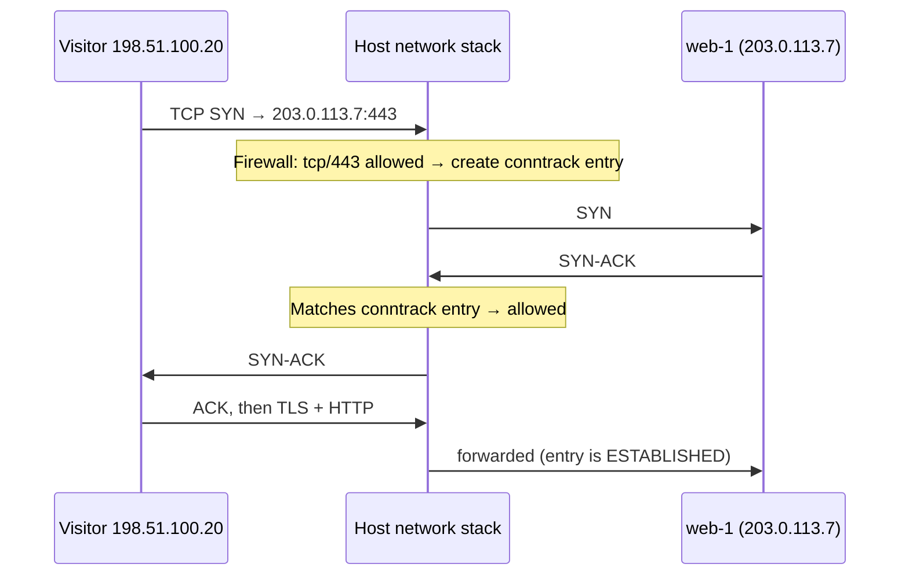
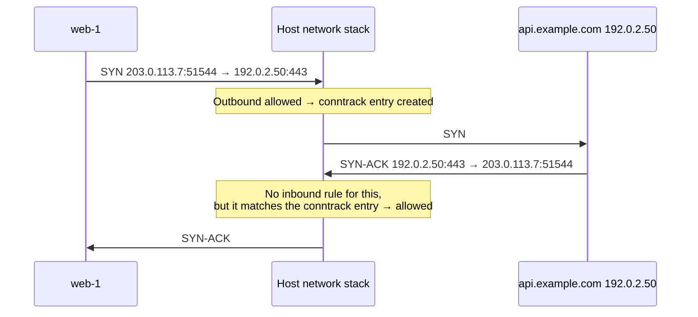
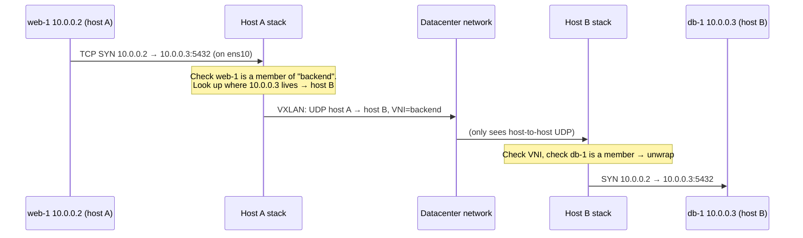

# Packet walkthroughs

Concrete examples of what happens to a packet on each stack. The addresses are made up:

| Thing | Address |
|---|---|
| Your server `web-1`, public | `203.0.113.7` |
| Your server `web-1`, private | `10.0.0.2` on network `backend` |
| Your server `db-1`, private (another host) | `10.0.0.3` |
| A visitor on the internet | `198.51.100.20` |

`web-1` has a Cloud Firewall that allows inbound TCP 22 and 443, and nothing else inbound.

Steps marked **(OVS)** or **(hcnet)** differ between the stacks. Steps without a marker are the same on both.

---

## 1. A visitor opens `https://203.0.113.7`



1. The SYN arrives on the host's uplink. Linux routing on the host knows `203.0.113.7` lives on this host and hands the packet to the stack.
2. **(OVS)** OVS matches flows for `web-1`'s port. The firewall flow sends the packet to netfilter conntrack with `ct(commit)`, and `ctcount` counts it against the 80,000 limit.
   **(hcnet)** The packet reaches `web-1`'s compiled firewall program. The rule for tcp/443 matches, and the program adds an entry to `web-1`'s own IPv4 connection map (limit 120,000).
3. The packet is delivered to `web-1`'s virtual NIC.
   **(hcnet)** The packet arrives exactly as it came off the wire, not merged with others. For a large download *to* `web-1`, that means many more packets, all handled by one vCPU (see [benchmarks](benchmarks.md#why-plain-tcp-throughput-drops)).
4. `web-1` replies with SYN-ACK. The firewall finds the matching entry and lets it out, even though there is no outbound rule.

## 2. `web-1` calls an external API

`web-1` runs `curl https://api.example.com`. There are no outbound rules, so all outbound traffic is allowed, which is the Hetzner default.



The reply only gets in because of the connection-tracking entry. There is no inbound rule that allows "TCP from port 443 to port 51544". **This is the kind of traffic that breaks when the table is full** (see example 5).

## 3. `web-1` talks to `db-1` over the private network



1. `web-1` sends from its private interface (`ens10` or `enp7s0`, depending on the image).
2. Host A checks that `web-1` is really allowed to use `10.0.0.2` on network `backend`, and finds the host that runs `10.0.0.3`.
3. Host A wraps the frame in VXLAN with `backend`'s VNI and sends it to host B as plain UDP.
4. Host B checks the VNI and that `db-1` is a member of that network, removes the wrapper, and delivers the frame.
5. Cloud Firewalls don't apply here. Hetzner Cloud Firewalls only filter traffic on the public interface, so private-network traffic isn't filtered and doesn't use the firewall's connection table. Network membership is the access control. Use a firewall inside the VM if you need finer rules.

Note the MTU: private interfaces use **1450**, not 1500, because VXLAN adds about 50 bytes.

```console
$ ip link show ens10 | grep -o 'mtu [0-9]*'
mtu 1450
```

## 4. Someone tries to spoof an address

Suppose a compromised VM on the same host tries to send traffic pretending to be `web-1`:

```text
from VM "evil": src 203.0.113.7 → dst 198.51.100.99
```

- **(OVS)** Table 3 checks the source IP against the addresses assigned to `evil`'s port. `203.0.113.7` isn't one of them, so the packet is dropped silently.
- **(hcnet)** The packet is dropped, and the host sends back an ICMP *Destination Unreachable, Communication Administratively Prohibited*. `evil` gets an immediate error instead of a silent timeout. Tools like `ping` and `traceroute` usually show this as "Packet filtered" or `!X`.

The same ICMP reply is used when a VM tries to send to an address that isn't globally routable, for example a private `192.168.x.x` address out of the public interface.

## 5. The connection table is full

`web-1` is a busy WebSocket server. It holds 85,000 open client connections and also talks to an external API.

**On the standard stack:**

```text
85,000 tracked connections > 80,000 limit
→ new SYNs to :443 are dropped                    (new visitors time out)
→ new outbound connections are dropped too       (curl api.example.com hangs)
→ existing connections keep working
```

Symptoms: new connections time out, while CPU, memory and bandwidth look normal. It recovers on its own as connections close.

**On hcnet:** 85,000 is below the 120,000 IPv4 limit, so nothing happens. Now suppose the server grows to 130,000 IPv4 connections:

```text
130,000 > 120,000 limit → stop tracking new connections, check rules only
→ new SYNs to :443: rule "allow tcp/443" matches  → delivered ✓ (new visitors still get in)
→ SYN-ACK from api.example.com:443 → :51544:
     no inbound rule matches, and no tracked entry → dropped ✗
```

Inbound services that have an explicit rule keep working. Outbound calls, whose replies need a tracked entry, are the ones that fail. IPv6 connections have their own 120,000 budget, so they are unaffected.

A workaround if you expect to hit the limit: add explicit inbound rules for the replies you depend on. For example, allow TCP from the public IP addresses of an external API you call. Better still, keep the server under the limit (see [Connection tracking in practice](conntrack-in-practice.md)).

## 6. `cloud-init` reads the metadata server

```console
$ curl -s http://169.254.169.254/hetzner/v1/metadata/hostname
web-1
```

- **(OVS)** The request goes to a small network namespace on the host dedicated to `web-1`, where a metadata proxy answers it.
- **(hcnet)** hcnet answers it, over IPv4 or IPv6 (`fe80::a9fe:a9fe`), on any interface. DHCP pushes a specific route for the metadata server on each interface.

Check which interface your server uses to reach it:

```console
$ ip route get 169.254.169.254
169.254.169.254 via 172.31.1.1 dev eth0 src 203.0.113.7
```

If that says `dev ens10` on a server that also has a public interface, right after switching back from hcnet, you may have hit the stale-route issue. See the [switching guide](switching-guide.md#troubleshooting).

## 7. A large fragmented UDP response

`web-1` resolves a name whose DNS response is 3,000 bytes, larger than the MTU, so it arrives as three IPv4 fragments. Outbound UDP is allowed, so the response is a reply to a tracked query.

```text
fragment 1 (has UDP header, src port 53)  → matches the tracked query → allowed, decision remembered
fragment 2 (no UDP header)                → same fragment ID → allowed
fragment 3                                → allowed
```

If fragment 2 overtakes fragment 1 on the way:

```text
fragment 2 arrives first → ports unknown → only rules without ports can match
                           (e.g. "allow all UDP from 1.1.1.1") → otherwise dropped
```

This is rare. If you rely on large UDP responses from fixed peers, a rule that matches on source IP only, without ports, makes it robust.
